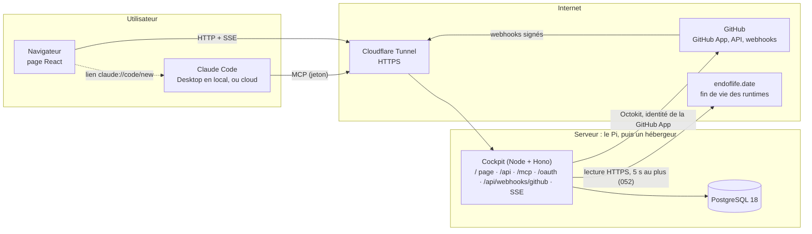

# Architecture de Cockpit

> L'état d'ensemble, à jour au **2026-11-07**. Il résume les décisions de [`decisions/`](decisions/), qui gardent le détail et le pourquoi de chaque choix. En cas de désaccord, c'est la décision la plus récente qui fait foi, et ce document doit être corrigé.

## En une phrase

Cockpit est un **service en ligne** : un seul serveur Node (Hono) sert la page React, l'API, le serveur MCP et les webhooks GitHub, et garde ses données dans **PostgreSQL**. Il **n'appelle jamais Claude** : ce sont les sessions Claude Code de chaque utilisateur qui viennent à lui par le MCP.

## Vue d'ensemble

- **Le navigateur** ouvre Claude Desktop sur le PC avec un lien `claude://code/new` ([005](decisions/005-lancement-local.md)). Cockpit ne voit jamais le PC.
- **Claude** s'identifie comme connecteur claude.ai, par OAuth ([006](decisions/006-connexion-oauth.md), [021](decisions/021-connecter-claude.md)), ou avec un jeton MCP créé à la main ([004](decisions/004-outils-mcp.md)).
- **GitHub** reste la source de vérité du code, des PR et de la CI. Cockpit n'en garde qu'une copie de cache, tenue à jour par les webhooks ([002](decisions/002-modele-donnees.md)).

## Les briques

| Brique | Choix | Décision |
|---|---|---|
| Langage | TypeScript strict, exécuté directement par Node (*type stripping*) | [001](decisions/001-stack.md) |
| Serveur | Node.js 24, Hono | [001](decisions/001-stack.md) |
| Base | **PostgreSQL 18**, pilote `pg`, Drizzle et drizzle-kit | [008](decisions/008-service-en-ligne.md) (remplace SQLite) |
| Validation | Zod, sur toutes les entrées | [001](decisions/001-stack.md) |
| Temps réel | SSE minimal : « tel objet a changé », puis rechargement par l'API | [001](decisions/001-stack.md) |
| Interface | React, Vite, React Router, TanStack Query, Tailwind v4, shadcn/ui ; style « Quatre temps », polices Urbanist et JetBrains Mono (`@fontsource-variable`) | [001](decisions/001-stack.md), [003](decisions/003-interface.md), [045](decisions/045-interface-quatre-temps.md) |
| GitHub | Une seule GitHub App, **créée par l'assistant de démarrage** à partir d'un manifeste ([012](decisions/012-configuration-automatique.md)), installée par chaque utilisateur ; connexion par son flux web, en `fetch` ; Octokit (`@octokit/app`) pour l'API des repos, avec l'identité de l'App seule (2.1) | [001](decisions/001-stack.md), [002](decisions/002-modele-donnees.md), [009](decisions/009-connexion-github.md), [011](decisions/011-import-projets.md) |
| Sessions | Cookie aléatoire de 30 jours, seule son empreinte SHA-256 en base ; aucun jeton GitHub de l'utilisateur gardé | [009](decisions/009-connexion-github.md) |
| MCP | SDK officiel (`@modelcontextprotocol/sdk`), transport HTTP en mode sans session et réponses JSON, à l'adresse `/mcp` ; jeton vérifié avant le SDK | [004](decisions/004-outils-mcp.md), [016](decisions/016-serveur-mcp.md) |
| OAuth | Cockpit est le serveur d'autorisation de son connecteur : métadonnées RFC 9728 et 8414, client reconnu par son document CIMD (les deux adresses publiées par Claude seulement : claude.ai et Claude Code), PKCE `S256`, code de 60 secondes en mémoire, jetons dans `mcp_tokens` (accès d'une heure, rafraîchissement de 90 jours remplacé sur la même ligne) | [006](decisions/006-connexion-oauth.md), [021](decisions/021-connecter-claude.md) |
| Tests | Vitest, Testing Library, **PGlite** (PostgreSQL en mémoire), faux GitHub | [001](decisions/001-stack.md), [008](decisions/008-service-en-ligne.md) |
| Qualité | Biome (lint et format), `tsc` ; la CI lance lint, typecheck, tests et build | [001](decisions/001-stack.md) |
| Exposition | Cloudflare Tunnel, sur le domaine de Dorian | [008](decisions/008-service-en-ligne.md) |
| Configuration | Une variable seulement, `DATABASE_URL` ; la GitHub App, son adresse publique et le premier administrateur viennent de l'assistant de démarrage, gardés dans la table `instance_settings` | [012](decisions/012-configuration-automatique.md) |
| Secrets de l'App | Secret OAuth, clé privée et secret des webhooks chiffrés en base (AES-256-GCM) ; la clé de chiffrement est générée au premier lancement dans un volume Docker à part (`secrets`) | [012](decisions/012-configuration-automatique.md) |

## Les règles qui tiennent l'architecture

Ce sont les points sur lesquels tout le reste s'appuie. Les changer, c'est revenir sur une décision.

1. **L'humain garde la main.** Valider, abandonner, merger : aucun outil MCP ne le permet. La table des droits est testée ligne par ligne ([004](decisions/004-outils-mcp.md)).
2. **Une seule fonction d'accès.** Tout objet remonte à son projet, et une seule fonction vérifie que l'utilisateur en est **membre** ([002](decisions/002-modele-donnees.md), [008](decisions/008-service-en-ligne.md)). Un objet d'un autre utilisateur répond « introuvable ».
3. **Une action métier = une transaction.** On vérifie le droit, on applique le changement et on écrit l'entrée d'historique **dans la même transaction**, ou rien n'est fait (tranche 1.4).
4. **Historique inaltérable.** Des triggers PostgreSQL refusent `UPDATE`, `DELETE` et `TRUNCATE`. Chez l'hébergeur, l'application n'aura en plus aucun droit d'écriture sur cette table hors `INSERT` ([008](decisions/008-service-en-ligne.md)).
5. **La base fait respecter ce qu'elle peut** : statuts par `CHECK`, un seul run actif par US par index unique conditionnel, un seul membre par projet au MVP par index unique ([002](decisions/002-modele-donnees.md)).
6. **On ne stocke pas ce qui se calcule** : l'étape d'un ticket, le Kanban, le verdict d'un run, le bilan de santé ([002](decisions/002-modele-donnees.md)).
7. **Aucun secret en clair** : jetons stockés par empreinte et affichés une seule fois ; secrets de la GitHub App chiffrés en base, avec une clé qui n'est jamais dans la base ni dans ses sauvegardes ([012](decisions/012-configuration-automatique.md)) ; aucune donnée personnelle en clair dans l'historique ([004](decisions/004-outils-mcp.md), [008](decisions/008-service-en-ligne.md)).
8. **Les erreurs se voient** : à l'écran, avec « Réessayer » ; au démarrage, le serveur refuse de partir sans `DATABASE_URL`.
9. **Les tests n'appellent jamais Claude ni le vrai GitHub** : routes testées avec `app.request()` sur PGlite, écrans avec un `fetch` simulé.

## Les données

Le modèle complet est dans la [002](decisions/002-modele-donnees.md), modifiée par la [008](decisions/008-service-en-ligne.md) :

| Domaine | Tables |
|---|---|
| Comptes | `users` (dont `is_admin` et `blocked_at`, 1.6), `sessions`, `mcp_tokens` (4.1 ; seule l'empreinte SHA-256 est stockée ; `history.token_id` depuis la 4.2 ; `client_id`, `refresh_hash`, `expires_at` et `refresh_expires_at` pour les connexions OAuth, 4.7) |
| Instance | `instance_settings` : une seule ligne, remplie par l'assistant de démarrage ([012](decisions/012-configuration-automatique.md)) |
| Projets | `projects` (un repo GitHub = un projet ; le planning de l'écriture des US et son dernier lancement, colonnes `routine_*`, 4.8), `project_members` |
| Lanceur cloud | `cloud_launchers` (14.1) : une ligne par utilisateur, comme `write_us_routines` (adresse et jeton chiffré) ; `cloud_launches` : une session demandée (US, branche, résultat de `/fire`, session, raison signalée, run rattaché) ; `project_members.in_launcher` : le projet est coché par ce membre |
| Routine d'écriture des US | `write_us_routines` (4.8) : une ligne par utilisateur, l'adresse de lancement et le jeton chiffré avec la clé de l'instance, jamais rendu par l'API |
| Travail | `tickets` (3.1 ; `history.ticket_id`, sans clé étrangère), `user_stories`, `acceptance_criteria`, `story_dependencies` (4.3 ; `history.story_id`, sans clé étrangère) |
| Développement | `runs`, `run_steps`, `questions` |
| Webhooks | `webhook_deliveries` (5.1) : les livraisons de GitHub, enregistrées avant tout traitement, sans doublon par `X-GitHub-Delivery`, purgées après 30 jours ; `processed_at`, `claimed_at` et `attempts` tiennent le traitement (5.2) |
| Trace | `history`, sans clé étrangère, inaltérable |
| Après le MVP | `code_maps`, `findings`, `code_sources` et les colonnes `kind`, `reasoning` et `object_names` pour l'analyse et la reprise ([007](decisions/007-reprise-app-existante.md))  |

Conventions : dates en `timestamptz`, JSON en `jsonb`, identifiants entiers `identity`, identifiants GitHub en `bigint`, valeurs fermées en texte avec `CHECK`. Les migrations sont générées par drizzle-kit, appliquées au démarrage, et ne sont jamais modifiées une fois appliquées.

## Déploiement

| | Phase 1 : le Pi | Phase 2 : un hébergeur |
|---|---|---|
| Quand | Dorian et des proches | Dès les premiers clients payants |
| Cockpit | Image Docker (Node, serveur, page construite) | La même image |
| PostgreSQL | Conteneur, données dans un volume | Service géré : sauvegarde continue, restauration à une date |
| Sauvegarde | `scripts/backup.sh` lancé chaque jour par cron : `pg_dump` compressé, 14 jours gardés | Fournie par l'hébergeur |
| Exposition | Cloudflare Tunnel (`cloudflared`), aucun port ouvert ; avec Cloudflare Access, `/mcp`, `/.well-known/*`, `/oauth/token` et `/api/webhooks/github` en « Bypass » ([021](decisions/021-connecter-claude.md)) | Selon l'hébergeur |
| Mise en production | Workflow CD lancé à la main, runner sur le Pi, `scripts/deploy.sh` (refuse de partir sans ses secrets, vérifie la version servie) | À définir |
| Secrets | `/etc/cockpit/cockpit.env` sur le Pi (`TUNNEL_TOKEN` à saisir, `POSTGRES_PASSWORD` généré par `deploy.sh`), hors du repo : le checkout du CD efface les fichiers non suivis. La clé de chiffrement des secrets de la GitHub App vit dans le volume `secrets`, dont une copie est gardée hors du Pi | Gestion des secrets de l'hébergeur |

Le code ne contient rien de propre au Pi : tout passe par `DATABASE_URL`, `PORT` et `COCKPIT_KEY_FILE` (l'emplacement de la clé de chiffrement). Passer de la phase 1 à la phase 2, c'est déplacer l'image et la base.

## Montée en charge

- **La charge est faible par nature** : Cockpit ne fait tourner aucun modèle d'IA. Mille runs en parallèle représentent de l'ordre de cent écritures par seconde, ce qu'un seul serveur tient.
- **Une seule instance d'abord.** La règle : ce qui doit survivre à un redémarrage va en base. Quatre choses restent en mémoire et devront passer en base avant une deuxième instance : connexions SSE (par `LISTEN` / `NOTIFY`), codes d'autorisation OAuth et documents CIMD lus (021), et les créations de GitHub App en cours de l'assistant, valables une heure ([012](decisions/012-configuration-automatique.md)). Le MCP ne garde rien : il tourne déjà en mode sans session ([016](decisions/016-serveur-mcp.md), ce que la [008](decisions/008-service-en-ligne.md) demandait). Le reste n'est que du cache, perdu sans dommage : bilans de santé, configuration du webhook de l'App, et la clé qui signe les plans d'écriture (026 H : un plan signé ailleurs est relu sur GitHub).
- **La fin de vie des runtimes** (052 I) est un cache de plus en mémoire (24 heures par produit d'endoflife.date, un produit inconnu compris) : perdu sans dommage à un redémarrage, mais chaque instance a le sien. À passer en base avec les autres caches s'il y a plusieurs instances.
- **Webhooks : enregistrés d'abord, traités ensuite**, sans doublon grâce à `X-GitHub-Delivery` (5.1) ; traités juste après le 202 puis chaque minute, une livraison réservée à la fois (5.2).
- **La connexion à la base survit à un redémarrage de PostgreSQL** : le pool de connexions écoute ses erreurs au lieu de faire tomber le serveur (1.1 bis).

## Ce qui existe dans le code aujourd'hui

| Élément | État |
|---|---|
| Serveur Hono, route `/api/health`, page React servie par le serveur | Fait (1.1) |
| Table `users`, migrations appliquées au démarrage | Fait (1.1), passée à PostgreSQL en 1.1 bis |
| Tests serveur sur PGlite, tests d'écran, lint, typecheck, CI | Fait |
| Déploiement : `Dockerfile`, `compose.yaml` (app, PostgreSQL, tunnel), `scripts/deploy.sh`, `scripts/backup.sh` | Fait (1.2), en service sur le Pi ; procédure dans le README, « Déployer sur le Pi » |
| Test de bout en bout du déploiement (`scripts/smoke-test.sh`, job `docker` de la CI) | Fait (1.2) |
| Connexion avec GitHub : `/api/auth/login`, `/callback`, `/logout`, `/api/me`, table `sessions`, inscription ouverte et comptes bloqués (en 1.6, la liste de comptes autorisés ayant été abandonnée) | Fait (1.3) |
| Historique inaltérable : table `history` (triggers qui refusent `UPDATE`, `DELETE`, `TRUNCATE`), fonction `act` (action + entrée dans une transaction), `/api/history`, page Journal | Fait (1.4) |
| Projets : importer un repo de l'installation de l'App, lister, archiver (`/api/github/repositories`, `/api/projects`), tables `projects` et `project_members`, page Projets | Fait (2.1) |
| Bilan de santé d'un projet, relu sur GitHub à chaque affichage et jamais stocké en base (cache en mémoire adressé par le commit) : `/api/projects/:id/health` (quatre lignes `claude_md`, `ci`, `mcp`, `agents` (code `invalid_team` si `.claude/team.md` est illisible, 028), plus la ligne `webhook` depuis la 5.1 ; la ligne `catalog` des fichiers de Claude à jour s'insère entre `agents` et `webhook` depuis la 049, C1 ; les lignes `github_alerts` et `updates` suivent `webhook` depuis la 052, R6), page `/projets/:id` | Fait (2.2) |
| Assistant de démarrage : `/api/setup/status`, `/start`, `/callback` (code de démarrage, manifeste de la GitHub App, secrets chiffrés dans `instance_settings`, clé dans le volume `secrets`), premier administrateur, page « Installer Cockpit » ; plus aucune variable GitHub ; si l'App existe sans administrateur, `/api/setup/status` le dit (`hasAdmin: false`), le serveur réaffiche son code au lancement et la page « Récupérer l'administration » l'échange par `POST /api/setup/claim` (entrée `claim_admin`) contre un cookie à usage unique, comme l'assistant à sa fin (seule son empreinte en base, `instance_settings.admin_claim_hash`) : le compte qui se connecte ensuite avec lui devient administrateur | Fait (1.5) |
| Accueil des utilisateurs : inscription ouverte, comptes bloqués (`users.blocked_at`), `/api/settings/users` (GET) et `/api/settings/users/:id/block` et `/unblock` (POST ; administrateur seulement), page « Réglages » ; `/api/installation` ; à la connexion, renvoi vers `/bienvenue` si l'App n'est pas installée, et bandeau « Installer » sur les autres pages | Fait (1.6) |
| Tickets : créer, lister, lire, modifier, supprimer (`/api/projects/:id/tickets`, `/api/tickets/:id`), table `tickets`, étape « Nouveau » calculée, description rendue en markdown sans HTML brut (`react-markdown`), section « Tickets » de `/projets/:id` et page `/tickets/:id` (`GET /api/tickets/:id` donne à chaque US `criteriaCount`, `dependsOn` et `runId`, le dernier run, ajoutés par la 045) | Fait (3.1) |
| Jetons MCP : créer (secret `ckp_…` montré une fois, haché en base), lister, révoquer (`/api/me/tokens`, `/api/me/tokens/:id/revoke` ; chaque utilisateur, ses jetons seulement ; un jeton révoqué n'est plus listé, il est supprimé 3 mois plus tard par une purge quotidienne), table `mcp_tokens`, section des jetons MCP, aujourd'hui dans « Connecter Claude » de « Réglages » (045 I ; `/reglages/jetons` y renvoie), désormais ouvert à tous (« Utilisateurs » reste à l'administrateur) | Fait (4.1) |
| Serveur MCP : `POST /mcp` (jeton `Bearer ckp_…` vérifié avant le SDK, refus journalisés en `mcp_auth`), outils `list_projects`, `get_project`, `search`, `get_ticket` et `create_ticket`, chaque appel journalisé par `act` (acteur `claude`, origine `mcp`, `history.token_id`) ; le Journal nomme ces actions et écrit « Claude » | Fait (4.2) |
| Claude écrit les US : tables `user_stories`, `acceptance_criteria`, `story_dependencies`, outils MCP `list_tickets_needing_us`, `create_user_stories` (tout ou rien par appel, écriture d'un gros ticket en plusieurs appels avec `more_to_come` et `stories_written` (le nombre d'US déjà écrites, sinon refus `writing_moved_on`) puis close par `tickets.stories_written_at`, au plus 100 US par ticket, ticket relu `FOR UPDATE`) et `get_user_story`, `search`, `get_ticket` et `get_project` étendus, étape du ticket calculée par `ticketStep(ticket, statuts des US)`, `GET /api/stories/:id`, suppression d'un ticket refusée s'il a des US (409 `ticket_has_stories`), page `/us/:id` en lecture seule, skill `/write-us` dans `catalog/skills/write-us/SKILL.md` | Fait (4.3) |
| Décisions humaines sur une US : routes `POST /api/stories/:id/validate`, `PATCH /api/stories/:id`, `POST /api/stories/:id/send-back` (commentaire obligatoire), `POST /api/stories/:id/abandon` et `POST /api/tickets/:id/abandon` (ses US non terminées passent `abandoned`), chacune dans un `act` après `assertActive`, l'US relue `FOR UPDATE` puis son statut vérifié (409 `wrong_status`, `project_archived`, `ticket_abandoned`), outil MCP `update_user_story` (seulement `to_rewrite` → `to_validate`), table des droits testée ligne par ligne (par ce qui n'existe pas), `GET /api/stories/:id/history` (une requête, entrées de l'utilisateur, sans les lectures), page `/us/:id` avec ses boutons et son historique replié, « Abandonner le ticket » sur `/tickets/:id`, skill `/write-us` qui réécrit | Fait (4.4) |
| Kanban par projet : `GET /api/projects/:id/stories` (une requête, les US non abandonnées avec le titre de leur ticket, sans entrée d'historique ; chaque US porte aussi `prNumber`, `prCiState`, `criteriaCount` et `questionPending`, ajoutés par la 045), section « Kanban » de `/projets/:id` au-dessus des tickets (cinq colonnes À valider / Prêtes / En cours / En revue / Terminées, cartes-liens vers `/us/:id`, sans bouton ni glisser-déposer), requête `["stories", projet]` invalidée par les décisions sur une US, l'abandon et le renommage d'un ticket | Fait (4.5) |
| Publication en issue GitHub : à la validation, l'US devient une issue (`renderIssue`, fonction pure : titre, corps en cases à cocher, label `cockpit: …`, ouverte ou fermée selon le statut), synchronisée par `syncIssue` **après** la transaction de la décision (validation, modification, abandon d'une US, abandon d'un ticket) et jamais dedans ; création réservée par `issue_claimed_at`, écritures de `githubClient` avec l'installation, `issue_number` et `issue_body_hash` sur l'US, une entrée `sync_issue` par synchronisation (`github_effects`, `error` sans message GitHub), `story.issue` avec `upToDate`, `POST /api/stories/:id/publish`, « Issue #N » et « Republier » sur `/us/:id` | Fait (4.6) |
| Connecter Claude : `GET /.well-known/oauth-protected-resource` (et `/mcp`) et `/oauth-authorization-server`, `WWW-Authenticate` sur le 401 de `/mcp`, `GET /oauth/authorize` (demande vérifiée, document CIMD lu en 5 s et 64 Kio, gardé 10 minutes), page `/autoriser` (`GET /api/oauth/request`, `POST /api/oauth/approve`), `POST /oauth/token` (`authorization_code` avec PKCE, `refresh_token` avec rotation sur la même ligne, erreurs RFC 6749), `GET /api/me/connect`, `kind` (`oauth` ou `manual`) sur les jetons listés, `/api/auth/login?next=` limité aux chemins `/autoriser`, entrées `oauth_authorize` et `oauth_token`, section « Connecter Claude » de « Réglages », ligne MCP du bilan de santé verte quand Cockpit est absent du `.mcp.json` | Fait (4.7) |
| Programmer l'écriture des US : `GET`, `PUT` et `DELETE /api/me/routine` (adresse `https://api.anthropic.com/v1/claude_code/routines/<id>/fire` vérifiée, jeton chiffré, jamais rendu), `GET` et `PUT /api/projects/:id/routine` (désactivée, à la demande, chaque jour, chaque semaine, heure du fuseau du navigateur, prochain passage cherché par quart d'heure, sur 15 jours avec `Intl.DateTimeFormat`), `POST /api/projects/:id/routine/run` (409 `routine_not_connected`, `routine_needs_reconnect`, `project_archived` ; 502 `fire_failed`), `runDueRoutines` toutes les minutes (`scheduleRoutines`, projet réservé par un `UPDATE` qui avance le prochain passage, rien lancé sans US à écrire ni sur un projet archivé, 401, 403 ou 404 de `/fire` : « à reconnecter »), entrées `connect_routine`, `disconnect_routine`, `schedule_routine`, `fire_write_us`, sections « Écrire les US automatiquement » de « Réglages » et « Écriture automatique des US » de `/projets/:id` | Fait (4.8) |
| Réglages en onglets et adresse publique en https : `CF-Visitor` lu avant `X-Forwarded-Proto` par l'assistant, `https://` exigé (sauf `localhost`, `127.0.0.1`, `[::1]`), ~~`GET` et `PUT /api/settings/public-url`~~ (retirés par 028), entrée `change_public_url` (`args: {}`, libellé gardé dans le Journal), onglets de Réglages (quatre, par 028), ~~section « Adresse publique »~~ (retirée par 028) | Fait (023) |
| Recevoir les webhooks : `POST /api/webhooks/github` (sans session, 503 si l'instance n'est pas configurée ; exemptée de la limite de 256 Kio de `/api/*` : sa limite est de 25 Mio, 413 au-delà ; signature `X-Hub-Signature-256` vérifiée en temps constant sur le corps brut avant tout, 401 sinon ; 400 si les en-têtes ou le corps sont invalides), table `webhook_deliveries` (clé `X-GitHub-Delivery`, `processed_at` vide : rien n'est encore traité), insérée avec l'entrée `receive_webhook` (acteur `github`, origine `webhook`, projet et propriétaire du repo suivi) dans une transaction, purgée après 30 jours par la purge quotidienne ; `GET /api/history` ajoute `event` à ces entrées ; cinquième ligne `webhook` du bilan (`GET /app/hook/config` et `/app/hook/deliveries?per_page=1` lus comme l'App, gardés une minute en mémoire hors du cache par commit ; `wrong_url`, `last_delivery_failed`, `unknown`) ; le changement d'adresse du webhook (`PATCH /app/hook/config`, `PUT /api/settings/public-url`) est retiré par 028 | Fait (5.1) |
| Une issue modifiée sur GitHub : `processDeliveries` (une livraison réservée par un `UPDATE` atomique sur `claimed_at`, traitée selon `event` et `action`, `processed_at` rempli ; un échec compte une tentative, la cinquième marque la livraison traitée avec l'entrée `process_webhook`), lancé après le 202 et par `scheduleDeliveries` chaque minute ; `issues.edited` hors de l'App comparé à `renderIssue` (fins de ligne CRLF de l'éditeur web ramenées à LF), version de GitHub gardée sur l'US (`issue_github_title`, `issue_github_body`, `issue_diverged_at`) et entrée `issue_diverged` ; la synchronisation n'écrit plus sur GitHub tant que l'écart dure ; `story.issue.diverged`, `issueDiverged` sur les cartes du Kanban ; `parseIssue` (inverse de `renderIssue`), `POST /api/stories/:id/issue/keep-cockpit` et `/take-github` (409 `no_divergence`, `not_template`), entrées `keep_cockpit_issue` et `take_github_issue` ; `diffLines` (plus longue sous-suite commune, repli au-delà de 2 000 lignes), section « Issue modifiée sur GitHub » de `/us/:id` | Fait (5.2) |
| Écrire dans un repo sans rien écraser, sans écran ni route : `planRepoWrite` (branche par défaut et son commit, puis, pour chaque fichier, l'arbre Git de son dossier et de ses parents à ce commit : `create`, `same` ou `exists` (avec le contenu actuel, ou sans pour un dossier, un lien, un sous-module, un fichier trop gros ou un parent qui n'est pas un vrai dossier), jamais écrasé ; chemins et tailles validés, une exception sinon) et `applyRepoWrite` (un seul commit par l'API Git : arbre sur `base_tree`, commit, branche avancée avec `force: false` ; les fichiers à créer sont relus au commit de la branche, sauf si le plan est signé (HMAC, clé tirée au démarrage) et la branche inchangée ; chaque arbre n'est lu qu'une fois par appel ; branche par défaut protégée : branche `cockpit/<7>` et pull request ouverte, `pullRequest` dans le résultat) du client GitHub ; refus rendus, jamais levés : `empty_repo`, `repo_unreachable`, `repo_changed`, `pull_request_forbidden` ; rien n'est écrit ni appelé quand aucun fichier n'est à créer | Fait (6.1) |
| Préparer un repo pour Claude : `POST /api/projects/:id/prepare` (lit le plan de 026 pour les fichiers de `catalog/` : quatre agents (dont `cartographer`), `rules-analyst` (R2), les skills `/dev-us`, `/write-us` et `/analyser`, et un `CLAUDE.md` de départ que `unlessExists` laisse hors du plan quand `CLAUDE.md` ou `.claude/CLAUDE.md` existe ; n'écrit rien dans l'historique ; un fichier d'une ancienne version d'origine y a le statut `update`, depuis la 049 : `/prepare/apply` ne l'accepte qu'avec le texte du catalogue, et les empreintes écrites vont dans `catalog_writes`) et `POST /api/projects/:id/prepare/apply` (`{ plan }`, un commit « feat: prepare the repo for Claude (Cockpit) » ; un plan mal formé ou un chemin refusé par 026 D : 400 ; les refus de 026 : 409 avec leur code, `pull_request_forbidden` avec `appSettingsUrl` ; une erreur de GitHub : 502) ; entrée `prepare_repo` (`args: { created }`, `github_effects: { commitSha, pullRequest }`) ; bouton « Préparer pour Claude » et liste des fichiers dans le bilan de santé de `/projets/:id` ; le `Dockerfile` copie `catalog/` | Fait (6.2) |
| Éditeur d'agent (030) : `GET /api/projects/:id/agents` (`{ agents, catalog }`, n'écrit rien dans l'historique) et `POST /api/projects/:id/agents/apply` (`{ name, before, after }`, un commit « feat: add / update / remove the agent <nom> (Cockpit) » via `applyRepoChanges` du client GitHub, refus `repo_changed` si le fichier n'est plus `before` ; limite de corps de 4 Mio pour cette route seule) ; entrées `save_agent` et `delete_agent` (`args: { path }`, `github_effects: { commitSha, pullRequest }`) ; cinquième onglet « Agents » (`/projets/:id/agents`) | Fait (E2) |
| L'équipe en graphe (031) : `GET /api/projects/:id/agents` rend en plus `team` (texte de `.claude/team.md`, `null` sans fichier) et `POST /api/projects/:id/team/apply` (`{ before, after }`, un commit « feat: update the team (Cockpit) » via `applyRepoChanges`, comme `agents/apply` dont il partage le corps ; `after` refusé en 400 s'il n'est pas lu par `parseTeam` ou dépasse 1 Mio ; même limite de corps de 4 Mio) ; entrée `save_team` (`args: { path }`, `github_effects`) ; section « Équipe » de l'onglet « Agents » : graphe de cartes (dépendance `@xyflow/react` 12.12.0, thémée par les jetons de `styles.css`, masqué en largeur téléphone), liste des étapes, panneau, diff et commit ; lecture et écriture du fichier dans `src/web/team-file.ts` | Fait (E3) |
| Plusieurs équipes par projet (032) : `.claude/teams/<nom>.md` (nom au format d'un agent, 238 caractères au plus pour tenir en 255) ; `GET /api/projects/:id/agents` rend en plus `teams: [{ name, text }]` (`""` pour une entrée illisible) ; `POST /api/projects/:id/team/apply` prend un `name` optionnel (`after: null` seulement avec un nom : suppression, commit « feat: remove the team <nom> (Cockpit) ») ; entrées `save_team` et `delete_team` (`args: { path }`) ; la ligne `agents` du bilan vérifie aussi chaque équipe nommée (lue une fois, dans la vague de `team.md`) ; liste « Équipe » dans la section du même nom, « Nouvelle équipe » dans une fenêtre (042) et l'onglet sur deux colonnes à partir de `lg` (équipe à gauche, agents à droite) ; `/dev-us <US> --team <nom>` dans le skill du catalogue | Fait (E4) |
| Le run minimal (033) : tables `runs` et `run_steps` (index unique sur `story_id` où `status = 'running'`), colonnes `user_stories.branch` et `history.run_id` ; outils MCP `start_run`, `report_step`, `finish_run` ; `get_user_story` rend `branch` et `active_run_id` ; `GET /api/runs/:id`, `runs` dans `GET /api/stories/:id` ; `GET /api/events` (SSE `change`, `run:<id>` et `story:<id>`, abonnés en mémoire, après la transaction, vers les membres du projet) ; page `/runs/:id`, liste des runs sur la page de l'US, libellés du Journal ; `/dev-us` rend compte de son run | Fait (7.1) |
| La fenêtre « Développer avec Claude » (034) : `GET /api/projects/:id/branches` (`{ branches }`, première page de GitHub lue comme l'App, rien dans l'historique), `story.branch` dans `GET /api/stories/:id`, panneau de `/us/:id` (`DevelopWindow.tsx`) qui compose le lien `claude://code/new?folder=…&q=…` ; `/dev-us` passe le prompt complémentaire à `start_run` en `comment` | Fait (7.2) |
| Critères et PR (035) : `report_criterion` (résultat et preuve sur le critère, avec le run), `link_pull_request` (PR lue sur GitHub comme l'App, US `in_review`, `pr_number`), `finish_run` `succeeded` refusé sans PR ; résultats dans `get_user_story`, `GET /api/stories/:id` et `GET /api/runs/:id`, section « Critères » du run, lien « PR #12 » de l'US (« PR n° 12 » avant la 045) | Fait (7.3) |
| Les questions de Claude (036) : table `questions` (index unique sur `run_id` où `answer` est vide), outils MCP `ask_user` (`question_pending`) et `get_answer` (une lecture, `stop_requested` à `false`), `POST /api/questions/:id/answer` (409 `already_answered`, `run_finished`, `project_archived`, entrée `answer_question`), `questions` dans `GET /api/runs/:id`, section « Questions » de `/runs/:id`, libellés du Journal ; `/dev-us` pose ses questions et relit la réponse à 30 s, 1 min, 2 min, puis toutes les 5 min | Fait (7.4) |
| Arrêter, relancer, fermer (037) : `POST /api/runs/:id/stop` (`stop_requested_at`, `stop_requested: true` dans `report_step` et `get_answer`, `finish_run` `failed` noté `stopped`) et `/close` (`closed_manually`, étapes closes, US `in_review` si PR sinon `ready`), entrées `request_stop` et `close_run`, `start_run` accepte une US `in_review`, boutons et « Relancer » sur `/runs/:id`, fenêtre « Développer » pour une US en revue, `/dev-us` s'arrête sur `stop_requested` | Fait (7.5) |
| Suivi de la PR (038) : `user_stories.pr_ci_state` et `pr_review_state` (cache), une fonction relit la PR comme l'App (PR, check runs du commit de tête, revues) pour les webhooks `pull_request`, `pull_request_review` et `check_suite` et pour `POST /api/stories/:id/pr/refresh` ; merge : US `done` (entrée `pull_request_merged`), fermée sans merge : `ready` sans PR (`pull_request_closed`) ; bloc « GitHub » et « Actualiser » sur l'US ; pour une US de reprise (050), la lecture lit aussi les fichiers de la PR (`readPullFiles`) | Fait (7.6) |
| Aide à la décision (039) : fonction pure `verdict` (`src/server/verdict.ts`, raisons dans un ordre fixe), `verdict` (null tant que le run tourne) et `prNumber`, `prCiState`, `prReviewState` de l'US dans `GET /api/runs/:id` ; en tête du run fini : « Acceptable » ou « À vérifier », les raisons, lien « Relire et merger sur GitHub », étapes dans « Journal détaillé » ; raison `app_code_changed` en dernier pour une US de reprise (050) | Fait (7.7) |
| Accueil (040) : `GET /api/home` (`src/server/home.ts`, quelques requêtes ensemble, rien de stocké) donne « À toi de jouer » (répondre, valider, relire, vérifier), « Claude travaille » et la pastille de chaque projet ; l'accueil connecté les affiche, répond aux questions sur place (`AnswerForm`) et le compteur de l'onglet « Accueil » lit la même route, tous deux rechargés à chaque `change` du flux ; chaque projet de « Projets » mène à `/projets/:id`, et « Dernièrement » montre les 5 dernières entrées de `GET /api/history` (clé `["home", "history"]`, rechargée avec l'accueil ; les lignes « répondre » portent `askedAt`, « valider » `criteriaCount` et `updatedAt`, « relire » `updatedAt`, ajoutés par la 045), qui donne aussi le `project` (nom actuel du repo, ou `null`) de chaque entrée, affiché aussi par le Journal | Fait (8.1) |
| Style Crème sombre, onglets, journal par pages, plus d'adresse publique : ~~jetons de `styles.css` (Geist et Geist Mono), barre du haut, onglets de projet et de Réglages~~ (remplacés par la 045, tranche 9.3), `GET /api/history` par 25 entrées (`{ entries, hasMore }`, `?before=<id>` sur le couple `at`, `id`, 400 `invalid_cursor`) et « Afficher plus » dans le Journal, `GET` et `PUT /api/settings/public-url` supprimés, l'assistant d'installation détecte l'adresse lui-même (`POST /api/setup/start` ne reçoit que `{ code }`, 400 si elle n'est pas en https, sauf boucle locale) (J) | Fait (028) |
| L'interface « Quatre temps » (045) : jetons de `src/web/styles.css` aux valeurs de la 045 B (neutres, quatre temps `idea`, `you`, `claude`, `done`, `destructive` = `you`), Urbanist et JetBrains Mono ; coque `src/web/Shell.tsx` (`Sidebar` de 224 px : Accueil avec son compteur, les projets qui ne sont pas au repos avec leur pastille `Dot`, Tous les projets, Importer un repo, Journal, Réglages et le compte ; `IdeaBar`, barre « Noter une idée » en bas ; `Panel`, panneau de droite de 380 px ; `StateSentence`, la phrase d'état en haut de chaque page ; `Breadcrumb` ; `useHome`, la requête de `GET /api/home` partagée par l'accueil, la barre latérale et la barre d'idée) ; formes et boutons communs dans `src/web/ui.ts` ; `TopBar` supprimée ; routes dans `App.tsx` : `/autoriser` hors de la coque, le reste dans `Shell`, `*` donne la page 404 (S56, sans l'écran « hors ligne ») ; projet en six onglets (sept depuis la 053) (`/projets/:id`, `/tickets`, `/conception` (R1, 043), `/sante`, `/agents`, `/reglages`, où passe l'écriture automatique des US ; `/projets/:id/ecriture-us` redirige vers `/reglages`) ; Kanban en six colonnes (« Idées » = tickets à l'étape `new`) ; « Développer avec Claude » dans le panneau de droite de `/us/:id` ; Réglages avec un menu à gauche (Connecter Claude avec les jetons MCP, Tâches cloud, Instance pour l'administrateur ; adresses `/reglages`, `/ecriture-us`, `/utilisateurs` ; `/jetons` renvoie à `/reglages`). Alignement ensuite des écrans construits sur leurs maquettes (logo mis à part) : « Valider » sur place dans les lignes « À valider » de l'accueil et dans les US d'un ticket (`POST /api/stories/:id/validate`), assistant d'installation en deux écrans (code, puis permissions de l'App) dans un rail de trois étapes, Réglages du projet (fréquence en cartes, « Sur ce PC · Dossier du clone », « Archiver le projet »), « Préparer pour Claude » en liste de fichiers avec aperçu, onglet Agents (puces d'équipe, commutateur Graphe / Liste, éditeur à côté du fichier), Journal groupé par jour, « Fermer le run ? » en fenêtre modale, `Ctrl Entrée` dans « Développer avec Claude » et dans la réponse à Claude, noms de projet sans le propriétaire ; les jetons MCP passent dans « Connecter Claude ». Limites : Chercher, favoris, Claude, Cette nuit, Équipes d'agents, onglets CI / CD et Historique (Conception : R1), entrées Préférences, Membres, Abonnement et Données de Réglages, barres d'étapes d'un run attendent leur tranche | Fait (9.3) |
| La carte du code (043, R1) : table `code_maps` (migration `0021`, unique par `(project_id, module_path)`, `data` en `jsonb`, nature contrainte par un `check`) ; `src/server/citations.ts`, `verifyCitations` (lit chaque fichier distinct une fois au commit cité avec `inspect` de la 026, rend le nombre de lignes par fichier ou le premier refus ; réutilisable par R2 et R5) ; `src/server/code-map.ts` (schéma Zod `codeMapArgs` et `moduleData`, utilisé à l'écriture et à la lecture ; `submitCodeMap` : refus sans GitHub d'abord, puis commit inconnu par la lecture de l'arbre de la racine, une fois par appel, puis citations, 100 fichiers distincts au plus, manifestes compris ; remplacement des modules de l'appel dans une transaction ; `LocatedRefusal` : texte avec l'endroit fautif pour Claude, code fixe dans l'historique) ; outil MCP `submit_code_map` (17 outils à l'époque de R1, 18 avec R2) ; routes `GET /api/projects/:id/code-map` (modules, commit, `commitsSince` par commit distinct, `null` si GitHub ne le retrouve pas ou si la comparaison de ce commit échoue ; App non configurée : 502 `github_unavailable` ; ligne corrompue ignorée et journalisée) et `GET /api/projects/:id/code?sha=&path=&start=&end=` (`{ firstLine, lines }`, trois lignes de contexte, lues sur GitHub, 404 hors de la carte ou si le commit a disparu, 502 `github_unavailable` pour une autre erreur de GitHub), réservées aux membres ; `github.ts` : `fileReader` (la lecture `inspect` seule), `commitsSince` (`ahead_by` de `compare`, `null` sur 404) et un chemin encodé segment par segment dans `inspect` ; web : onglet `ProjectConception.tsx` (`/projets/:id/conception`, entre Tickets et Santé, six onglets de projet), `ConceptionGraph.tsx` (React Flow, mise en page `@dagrejs/dagre`), `ConceptionObject.tsx` (panneau d'un objet, son code coloré par `CodeView` depuis R2), `AnalyseWindow.tsx` (fenêtre « Analyser avec Claude » ; « Ajouter /analyser au repo » réutilise `POST /prepare` et `/prepare/apply` avec les deux fichiers) ; `catalog/` : skill `analyser` et agent `cartographer`, soit 8 fichiers écrits par « Préparer pour Claude » (9 avec R2) | Fait (R1) |
| Les règles et l'écran de reprise (047, R2) : `src/server/takeover.ts` (schéma Zod `takeoverArgs`, `createTakeoverStories` : tout ou rien, ticket « Reprise : <feature> » avec `storiesWrittenAt` posé et US `kind = takeover` en `to_validate` dans une transaction, citations par `citationRefusal` de `code-map.ts` commun avec `submit_code_map` ; routes `GET /api/projects/:id/rules` (chaque règle rend aussi `storyStatus`, `asA` et `ticketTitle` depuis R3), `POST /api/criteria/:id/keep`, `/unkeep` et `/bug` (ticket « Bug : … » aux liens GitHub en chevrons, titre coupé à 200 caractères entiers, règle retirée de l'US, US abandonnée si c'était la dernière), `PATCH /api/criteria/:id` ; refus `not_takeover`, `wrong_status`, `ticket_abandoned`, `project_archived` ; entrées `keep_rule`, `unkeep_rule`, `edit_rule`, `bug_rule`) ; migrations `0022` (table `code_sources`, colonnes `summary`, `reasoning`, `doubt`, `object_names`, `takeover_state` de `acceptance_criteria`, `user_stories.kind`) et `0023` (index, `CHECK start_line >= 1`) ; outil MCP `create_takeover_stories` (18 outils au total) ; `get_user_story` et `GET /api/stories/:id` rendent `kind` et les champs de reprise des critères ; une US de reprise ne se renvoie pas, ne se réécrit pas (`update_user_story`, récit, `take-github`) : `takeover_story`, et sa validation répond 409 `rules_pending` tant qu'une règle est à trancher ; la route `GET /api/projects/:id/code` accepte aussi les fichiers et commits cités par une source de règle ; web : `Reprise.tsx` (`/projets/:id/conception/regles`, `?regle=`, raccourcis `V` `M` `B` `P` `J` `K`), puces « Modèle » et « Règles · N » de `ProjectConception.tsx` (`?objet=` ouvre un objet de la carte), `rules.ts`, cases « Carte » et « Règles » de `AnalyseWindow.tsx`, règles et lien « Juger dans l'écran de reprise » sur la page d'une US, `CodeView.tsx` avec `highlight.ts` (dépendance `shiki`, moteur JavaScript, thème `css-variables`, un chunk par langage, palette `--shiki-token-*` de `styles.css`) et `code-language.ts` ; `catalog/` : agent `rules-analyst`, soit 9 fichiers écrits par « Préparer pour Claude » | Fait (R2) |
| Le graphe par fonctionnalité (048, R3) : `takeover.ts` : `loadRules` prend une portée (`to_validate`, `features` : US et ticket non abandonnés, ou un critère) et les modules de la carte déjà lus, `loadFeatures` groupe les règles par ticket « Reprise : … » (acteurs sans doublon de casse, graphie première) et rend les liens de la carte entre objets cités (tous genres, sans doublon ni lien sur soi) ; route `GET /api/projects/:id/features` (`{ features, links }`, réservée aux membres, lecture seule) ; web : `features.ts` (client, fonctionnalité choisie par `?f=`, liens des clics), `features-markdown.ts` (export construit dans le navigateur, texte neutralisé), `ProjectFeatures.tsx` (écran, bascule Graphe / Liste, `FeaturesExport` : boutons « Exporter en Markdown » et « Tout le projet » dans l'en-tête de `ProjectPage.tsx`), `FeaturesGraph.tsx` (React Flow, quatre colonnes Acteurs, Fonctionnalités, Règles, Objets, `@dagrejs/dagre`), troisième puce « Fonctionnalités » de `ProjectConception.tsx`, route `/projets/:id/conception/fonctionnalites` ; `AnalyseWindow.tsx` : `initialRules` ouvre la fenêtre avec « Règles » cochée | Fait (R3) |
| Figer l'existant (050, R4) : `src/server/pr-files.ts` (`isTestPath`, `APP_FILES_KEPT` = 20), `readPullFiles` de `github.ts` (pages de 100, 30 au plus), lu dans `pr-follow.ts` avant la transaction pour une US `takeover` dont la PR est ouverte ou mergée ; colonnes `pr_app_files` et `pr_app_files_count` (migration `0025`), remises à nulles par une PR fermée sans merge ou une autre PR liée (`runs.ts`, qui efface aussi les caches de la CI et de la revue) ; `verdict.ts` : raison `app_code_changed` en dernier ; `GET /api/runs/:id` rend `kind`, `prAppFiles`, `prAppFilesCount` sur l'US, et l'accueil (`home.ts`) porte aussi la raison ; `RunVerdict.tsx` liste les fichiers (« + N autres ») ; `state: "frozen"` dans `GET /api/projects/:id/features` (`takeover.ts`), « figée » par `stateWord` de `features.ts` et sur `StoryPage.tsx` ; `catalog/` : `/dev-us`, `test-writer` et `reviewer` gagnent le mode « figer », `history.json` régénéré | Fait (R4) |
| La mise à jour du catalogue (049, C1) : table `catalog_writes` (migration `0024`, unique par `(project_id, path)`, SHA-256 du texte écrit, remplie par « Préparer », « Ajouter /analyser » et « Mettre à jour ») ; `src/server/catalog-update.ts` (`catalogStates` : `current`, `old`, `modified` ou `absent`, d'après l'empreinte gardée puis `catalog/history.json` ; la ligne `model:` n'est pas comparée depuis la 051 L) ; `npm run catalog:history` (`scripts/catalog-history.mjs`, refuse un clone superficiel) ; `.gitattributes` (`catalog/` en LF) ; ligne `catalog` du bilan (`{ key, ok, detail, files: [{ path, state }] }`, seulement pour un repo préparé) ; routes `POST /api/projects/:id/catalog/plan` et `/catalog/apply` (`{ files: [{ path, before }] }`, seuls les textes du catalogue sont écrits ; 400 hors catalogue, `CLAUDE.md`, ou `before` modifié à la main ou à jour ; 409 `not_prepared`, `repo_changed`, `pull_request_forbidden`) ; entrée `update_catalog` ; web : `CatalogLine.tsx` dans l'onglet Santé | Fait (C1) |
| Les constats de Claude (051, R5) : table `findings` et `code_sources.finding_id` (migration `0026`, exactement un de `criterion_id` et `finding_id`) ; `src/server/findings.ts` (`submitFindings` : refus sans GitHub, commit inconnu, citations par `verifyCitations`, `findings[i].sources[j]` pour l'endroit fautif, tout ou rien ; `upgrade` refusé jusqu'à R6 ; `listFindings`) ; outils MCP `submit_findings` et `list_findings` (20 outils au total) ; routes `GET /api/projects/:id/findings` (`?status=`, triés par gravité puis du plus récent, sources et `unprotected` calculé, jamais stocké) et `POST /api/findings/:id/ticket`, `/dismiss` et `/later` (409 `not_open` pour un constat `ticketed` ou `dismissed` ; entrées `ticket_finding`, `dismiss_finding`, `later_finding`) ; `GET /api/projects/:id/code` sert aussi les lignes citées par un constat ; « C'est un bug » (`takeover.ts`) crée un constat `bug` au statut `ticketed` ; `catalog/` : agents `bug-hunter`, `security-reviewer` et `architect`, skill `/analyser` étendu, soit 12 fichiers écrits par « Préparer pour Claude » et 11 états du catalogue ; `catalog-update.ts` : la ligne `model:` d'un agent est ignorée à la comparaison (et celles des versions passées essayées), gardée par « Mettre à jour », le plan et « Préparer » sur les fichiers `update` ; `catalog:history` liste les versions de la plus ancienne à la courante ; web : `Findings.tsx` (puce « Constats · N », `/projets/:id/conception/constats`), cases Bugs, Sécurité et Architecture et stack de `AnalyseWindow.tsx`, section « Agents d'analyse » de `ProjectAgents.tsx`, libellés du Journal | Fait (R5) |
| Les constats de GitHub et les versions (052, R6) : migration `0027` (`findings.source` accepte `github`, colonnes `github_alert_type`, `github_alert_number` et `github_closed_at`, index unique `(project_id, github_alert_type, github_alert_number)`, `CHECK` `findings_github_check` et `findings_commit_check` qui rend `commit_sha` facultatif pour un constat GitHub, type `upgrade`) ; `src/server/github-alerts.ts` (`POST /api/projects/:id/findings/refresh` rend `{ tools, created, updated, closed, access }`, 502 `github_unavailable` ; `receiveAlert` traite les webhooks `dependabot_alert`, `code_scanning_alert` et `secret_scanning_alert` ; entrée `refresh_github_alerts`) ; `github.ts` (`readAlerts` : 100 par page, 10 pages au plus, `hide_secret=true` ; `readSecretLocation` ; `readAppAccess` : `GET /app` et `GET /app/installations/{id}`) ; `webhooks.ts` retire `alert.secret` avant d'enregistrer la livraison ; `src/server/versions.ts` (`GET /api/projects/:id/versions`, endoflife.date lu avec `fetchEndOfLife`, cache en mémoire de 24 heures, rien en base) ; `src/server/dependabot.ts` (`GET /api/projects/:id/dependabot/plan` et `POST .../dependabot/apply`, entrée `add_dependabot`) ; `health.ts` : lignes `github_alerts` et `updates` (le bilan répond `claude_md`, `ci`, `mcp`, `agents`, `catalog` si le repo est préparé, `webhook`, `github_alerts`, `updates`) ; le manifeste de `setup.ts` demande `dependabot_alerts`, `security_events`, `secret_scanning_alerts` et les trois événements ; `catalog/` : agent `upgrade-advisor`, soit 13 fichiers écrits par « Préparer pour Claude » et 12 états du catalogue ; outils MCP inchangés (20) dont les descriptions citent `upgrade` ; web : `Findings.tsx` (« Actualiser », puce « Versions », lignes de fin de vie), `UpdatesLine.tsx`, `GithubAccess.tsx`, case « Versions » de `AnalyseWindow.tsx`, runtimes de `ProjectConception.tsx` | Fait (R6) |
| Le Journal filtrable et l'historique par projet (053, 11.1) : `GET /api/history` accepte `project`, `action`, `actor`, `origin`, `result` (liste séparée par des virgules), `since` (ISO 8601 avec fuseau) et `q` (400 `invalid_filter` pour une valeur vide ou hors liste), rend aussi `projectId`, `ticketId`, `storyId`, `runId`, `args`, `detail` et, pour un refus ou une erreur, `retry` (`{ id, at, result }` ou `null` : la première entrée suivante du même utilisateur, auteur, action et projet, dans l'heure) ; `GET /api/history/export` (mêmes filtres, sans `before`) rend un CSV de 11 colonnes, 10 000 entrées au plus, `Cache-Control: no-store` ; les deux sont dans `src/server/history.ts` et ne laissent pas d'entrée ; index `history_user_at_idx` (migration `0028`) ; web : `JournalPage.tsx` (filtres dans l'adresse), `JournalView.tsx` (liste par jour, menus, panneau d'une entrée, partagés), `ProjectHistory.tsx` (onglet `/projets/:id/historique`, le septième) | Fait (11.1) |
| Lancer dans le cloud (054, 14.1) : `src/server/launcher.ts` (`LAUNCHER_PROMPT`, `GET`, `PUT` et `DELETE /api/me/launcher`, `PUT /api/projects/:id/launcher`, `POST /api/stories/:id/launch` qui réserve une ligne de `cloud_launches` puis appelle `/fire` avec `launch_id: <id>`), outils MCP `get_launch` et `report_launch`, `start_run` accepte `launch_id` ; `GET /api/runs/:id` rend `cloud` ; `/dev-us` accepte `--launch` ; migration `0029` ; web : `LauncherSettings.tsx` (carte « Lanceur Cockpit » de « Tâches cloud »), `DevelopWindow.tsx` (cible « Dans le cloud » ou « Sur ce PC ») | Fait (14.1) |
| Les tickets complets (055, 11.2) : migration `0030` (colonnes `tickets.priority`, `text` `'normal'` avec `CHECK` sur `low`, `normal`, `high`, et `tickets.tags`, `text[]` vide) ; `POST /api/projects/:id/tickets` et `PATCH /api/tickets/:id` acceptent `priority` et `tags` (étiquettes normalisées, doublons fusionnés, 10 au plus ; 400 sinon), les `GET` les rendent, la liste est triée haute, normale, basse puis `id` décroissant ; `GET /api/projects/:id/search?q=` (membres, sous-chaîne sans casse, `strpos`) rend `{ tickets, stories }` de 50 au plus (une US trouvée par son récit, ses notes ou, par une sous-requête `exists`, ses critères ; son `title` est `i_want`) ; `get_ticket` rend `priority` et `tags` ; tout est dans `src/server/tickets.ts` ; web : `IdeaPanel.tsx` (le panneau de la barre « Noter une idée », dont `Shell.tsx` garde le brouillon), `TagField.tsx` (étiquettes en puces et champ), `TicketPanel.tsx` (le panneau de droite d'un ticket), `SafeMarkdown.tsx` (rendu Markdown sûr, 014 H, partagé avec la page du ticket), `ProjectTickets.tsx` réécrit (recherche, puces, menu « Étiquette », liste, panneau), `RunNowButton` extrait de `ProjectRoutine.tsx`, `fetchTickets` et les mots de priorité dans `src/web/tickets.ts` | Fait (11.2) |
| Importer les issues (056, 11.3) : migration `0031` (colonne `tickets.github_issue_number`, `integer` nul, et index unique `tickets_project_issue_idx` sur `(project_id, github_issue_number)`) ; `GET /api/projects/:id/issues` (membres) rend `{ issues: [{ number, title, state, kind, inCockpit }] }` lues sur GitHub par `listIssues` (`github.ts` : ouvertes et fermées, sans pull request, 10 pages de 100) ; `POST /api/projects/:id/issues/import` (`{ numbers }`, 1 à 200 ; 409 `project_archived`, 502 `github_unavailable`) relit les issues puis, dans un seul `act`, crée un ticket par issue ouverte pas encore connue (`onConflictDoNothing` sur l'index) et, si elle est écrite comme une US, une US `ready` avec ses critères, et rend `{ tickets, stories, skipped }` ; historique `import_issues` (les comptes) ; rien n'est écrit sur GitHub ; `readStoryIssue` (`src/server/issue-story.ts`, fonction pure) lit le récit et les critères d'un corps d'issue, avec les limites de `create_user_stories` ; les routes sont dans `src/server/issue-import.ts` ; le webhook `issues.edited` ignore l'issue d'une US importée tant que `issue_body_hash` est nul ; web : `IssueImport.tsx` (`/projets/:id/tickets/importer`, lien « Importer les issues » de `ProjectTickets.tsx` caché sur un projet archivé, et `ImportedFrom`, « Importé de l'issue #N ↗ » sur `TicketPage.tsx` et `TicketPanel.tsx`) | Fait (11.3) |

## Index des décisions

| # | Sujet | Statut | En bref |
|---|---|---|---|
| [001](decisions/001-stack.md) | Stack technique | Validée, modifiée par 008 | Node, Hono, React, Drizzle, Zod, SSE |
| [002](decisions/002-modele-donnees.md) | Modèle de données | Validée, modifiée par 008 | Tables du MVP, ce qui se calcule, historique |
| [003](decisions/003-interface.md) | Interface | Validée | « Qui doit agir ? », règles d'ergonomie, style |
| [004](decisions/004-outils-mcp.md) | Outils MCP | Validée | Ce que Claude peut faire, et ce qu'aucun outil ne fait |
| [005](decisions/005-lancement-local.md) | Lancement local | Validée | `claude://code/new`, modèle choisi par la fiche de chaque agent |
| [006](decisions/006-connexion-oauth.md) | Connexion OAuth | Validée, modifiée par 021 | Cockpit comme connecteur claude.ai ; prévue après le MVP, avancée en 4.7 par la 021 |
| [007](decisions/007-reprise-app-existante.md) | Analyser et reprendre une app existante | Proposée | La fonctionnalité phare : carte du modèle par sous-projet, règles et constats (bugs, failles, architecture, stack, versions) déposés par Claude en citant le code vérifié ; règles validées en regard du code, constats triés en tickets |
| [008](decisions/008-service-en-ligne.md) | Service en ligne | Validée | PostgreSQL, membres d'un projet, le Pi puis un hébergeur |
| [009](decisions/009-connexion-github.md) | Connexion avec GitHub | Validée | Flux web de la GitHub App, cookie de session, inscription ouverte et comptes bloqués (depuis la 012) |
| [010](decisions/010-historique.md) | Historique inaltérable | Validée | Triggers, `act` (une action = une transaction), pas de donnée personnelle dans les `args`, page Journal |
| [011](decisions/011-import-projets.md) | Importer et archiver un projet | Validée | Repos lus avec l'identité de l'App, rien cru du navigateur, une seule fonction d'accès, archivage sans désarchivage |
| [012](decisions/012-configuration-automatique.md) | Configuration automatique | Validée | Assistant de démarrage qui crée la GitHub App, secrets chiffrés en base, administrateur, mot de passe de la base généré |
| [013](decisions/013-bilan-de-sante.md) | Bilan de santé d'un projet | Validée | Quatre règles à codes fixes, relues sur GitHub à chaque affichage (cache en mémoire adressé par le commit, rien en base), corrections en 6.2 |
| [014](decisions/014-tickets.md) | Les tickets | Validée | Titre et description markdown, projet archivé en lecture seule, étape calculée (« Nouveau » tant qu'il n'y a pas d'US), `args` de l'historique sans texte, markdown sans HTML brut |
| [015](decisions/015-jetons-mcp.md) | Les jetons MCP | Validée | `ckp_` + 43 caractères, seule l'empreinte SHA-256 en base, montré une fois, 20 actifs par utilisateur, personnels (l'administrateur n'y touche pas), « Réglages » ouvert à tous |
| [016](decisions/016-serveur-mcp.md) | Le serveur MCP | Validée | SDK officiel en mode sans session et réponses JSON, jeton vérifié avant le SDK (401 et `mcp_auth`), cinq outils, refus et erreurs lus par Claude, `args` de l'historique réduits à des identifiants (règle 010 D, qui modifie la 004) |
| [017](decisions/017-user-stories.md) | Claude écrit les user stories | Validée | Trois tables, `create_user_stories` tout ou rien par appel, en plusieurs appels pour un gros ticket (`more_to_come`), `list_tickets_needing_us` et `get_user_story`, étape du ticket calculée avec ses US, page d'une US en lecture seule, skill `/write-us` (règles F et G de la 014 modifiées) |
| [018](decisions/018-decisions-humaines.md) | Les décisions humaines sur une US | Validée | Valider, modifier, renvoyer (commentaire obligatoire), abandonner une US et abandonner un ticket, `update_user_story` pour Claude, table des droits testée ligne par ligne, historique de l'US, chaque action relit l'US `FOR UPDATE` (modifie la table des droits de la 004) |
| [019](decisions/019-kanban.md) | Le Kanban d'un projet | Validée | `GET /api/projects/:id/stories` (US non abandonnées, ticket puis position), six colonnes depuis la 045 (« Idées » d'abord, tirée des tickets à l'étape `new`), calculées par statut, cartes-liens sans bouton, section au-dessus des tickets, invalidée par les décisions (018), l'abandon et le renommage d'un ticket |
| [020](decisions/020-issues-github.md) | La publication d'une US en issue GitHub | Validée | Issue créée à la validation et tenue à jour jusqu'au bout, gabarit unique (fonction pure), un label de statut `cockpit: …`, ouverte puis fermée, synchronisation hors transaction avec réservation de la création, `issue_body_hash` pour savoir si elle est à jour, entrée `sync_issue` (`github_effects`), « Republier » |
| [021](decisions/021-connecter-claude.md) | Connecter Claude à Cockpit | Validée | Met en œuvre la 006 avant les webhooks : connecteur claude.ai, les deux clients de Claude (claude.ai et Claude Code) par CIMD, consentement derrière la connexion GitHub, jetons OAuth dans `mcp_tokens`, section « Connecter Claude » en trois étapes, Cockpit absent du `.mcp.json` accepté |
| [022](decisions/022-routine-ecriture-us.md) | Programmer l'écriture des US depuis Cockpit | Validée | Une tâche planifiée par utilisateur créée sur claude.ai (consigne fournie), Cockpit tient le planning par projet et appelle son `/fire` (adresse vérifiée, jeton chiffré), rien lancé sans US à écrire, 401, 403 ou 404 : « à reconnecter » |
| [023](decisions/023-reglages-adresse-https.md) | Réglages en onglets, adresse publique en https | Validée | `CF-Visitor` pour détecter l'adresse, `https://` exigé (sauf boucle locale), ~~adresse modifiable par l'administrateur dans Réglages~~ (retirée par 028), ~~onglets « Général » et « Écriture automatique des US »~~ (quatre onglets, 028), partie repliée « Connecter Claude depuis le CLI Claude Code » |
| [024](decisions/024-webhooks.md) | Recevoir les webhooks GitHub | Validée | Signature vérifiée sur le corps brut, livraison enregistrée (`webhook_deliveries`, sans doublon par `X-GitHub-Delivery`) avant de répondre 202, entrée `receive_webhook`, traitement repoussé à la 5.2, ligne `webhook` du bilan lue sur l'App (adresse et dernière livraison, gardée une minute), ~~adresse du webhook changée avec l'adresse publique~~ (retirée par 028) |
| [025](decisions/025-issue-modifiee-sur-github.md) | Une issue modifiée sur GitHub | Validée | Livraisons traitées (réservées, reprises chaque minute, abandonnées à la cinquième tentative), `issues.edited` hors App comparé au rendu, version de GitHub gardée sur l'US et synchronisation suspendue, diff ligne à ligne, « Garder la version Cockpit » ou « Garder la version GitHub » (045) (gabarit relu, `not_template` sinon) |
| [026](decisions/026-ecrire-dans-un-repo.md) | Écrire dans un repo sans rien écraser | Validée | `planRepoWrite` (créer, déjà là, existe autrement : jamais écrasé) puis `applyRepoWrite` en un commit par l'API Git, branche avancée sans forcer, relecture de chaque fichier à créer avant d'écrire (`repo_changed`) sauf plan signé et branche inchangée (H), une lecture par arbre et par appel (H), pull request si la branche par défaut est protégée (G, Pull requests en écriture : 012 D modifiée), refus `empty_repo`, `repo_unreachable`, `pull_request_forbidden` |
| [027](decisions/027-preparer-pour-claude.md) | Préparer un repo pour Claude en un clic | Validée | Catalogue (`test-writer`, `developer`, `reviewer`, `/dev-us`, `/write-us`, `CLAUDE.md` de départ si aucun), plan montré fichier par fichier puis un commit (ou une PR si la branche est protégée), entrée `prepare_repo`, bouton dans le bilan de santé |
| [028](decisions/028-creme-sombre-onglets-journal.md) | Style Crème sombre, onglets, journal par pages, plus d'adresse publique dans Réglages | Validée | Jetons de `styles.css` et Geist (remplacés par la 045), barre du haut, journal de 25 entrées avec « Afficher plus » (`?before=<id>`), onglets du projet et de Réglages, plus de `public-url` (023 C et E, 024 G modifiés) |
| [029](decisions/029-equipe-d-agents.md) | Une équipe d'agents configurable par projet | Validée | `.claude/team.md` (étapes ordonnées, boucle possible) lu par `/dev-us` avec trois étapes par défaut, éditeur d'agent et écran « Équipe » (un commit, diff avant), règle F de la 013 modifiée (`invalid_team`), plusieurs équipes plus tard, le Leader est la session principale |
| [030](decisions/030-editeur-d-agent.md) | L'éditeur d'agent | Validée | Ajouter, modifier ou supprimer un agent de `.claude/agents/` (description, outils, modèle, prompt, aperçu) ; un commit montré avant, refus si le fichier a changé (modifie la 026 : remplacer ou supprimer, à la demande seulement) ; l'onglet montre aussi les agents d'analyse depuis la 051 L |
| [031](decisions/031-equipe-en-graphe.md) | L'équipe en graphe | Validée | Écran « Équipe » en graphe de cartes (suite d'étapes et boucles de retour, mise en page automatique) en plus de la liste, un commit ; un agent du catalogue passe par l'éditeur |
| [032](decisions/032-plusieurs-equipes.md) | Plusieurs équipes par projet | Validée | `.claude/teams/<nom>.md`, `/dev-us <US> --team <nom>`, la ligne `agents` du bilan vérifie aussi les équipes nommées |
| [033](decisions/033-run-minimal.md) | Le run minimal | Validée | Tables `runs` et `run_steps`, outils `start_run`, `report_step` et `finish_run`, un seul run actif par US, flux SSE, page du run |
| [034](decisions/034-developper-avec-claude.md) | La fenêtre « Développer avec Claude » | Validée | Panneau de la page de l'US, liste des branches lue sur GitHub, lien `claude://code/new` avec `/dev-us` prérempli, prompt complémentaire passé au run |
| [035](decisions/035-criteres-et-pr.md) | Critères et PR | Validée | `report_criterion` (résultat et preuve), `link_pull_request` (US « en revue »), `finish_run` `succeeded` refusé sans PR |
| [036](decisions/036-questions-de-claude.md) | Les questions de Claude | Validée | Table `questions`, `ask_user` et `get_answer`, réponse de l'humain sur la page du run, relecture de la réponse par `/dev-us` |
| [037](decisions/037-arreter-relancer-fermer.md) | Arrêter, relancer, fermer un run | Validée | Arrêt demandé lu à la prochaine étape, fermeture à la main d'un run muet, `start_run` accepte une US en revue (relance) |
| [038](decisions/038-suivi-de-la-pr.md) | Le suivi de la PR | Validée | Webhooks de la PR : merge termine l'US, fermeture la rend prête, CI et revue gardées en cache, bouton « Actualiser » |
| [039](decisions/039-aide-a-la-decision.md) | L'aide à la décision | Validée | Verdict « acceptable » ou « à vérifier » calculé (fonction pure) des critères et de la CI, avec ses raisons, en tête du run fini |
| [040](decisions/040-accueil.md) | L'accueil : qu'est-ce qui m'attend ? | Validée | `GET /api/home` : « À toi de jouer », « Claude travaille », pastille par projet, réponse sur place, « Dernièrement » |
| [041](decisions/041-nom-et-site-vitrine.md) | Le nom du produit et le site vitrine | Proposée | Dirigo, vitrine `dirigo.dev` dans un repo à part (Cloudflare Pages), app `app.dirigo.dev` au passage chez l'hébergeur, renommage du code dans une tranche dédiée |
| [042](decisions/042-nouvelle-equipe-fenetre.md) | « Nouvelle équipe » dans une fenêtre | Validée | La création d'une équipe s'ouvre dans une fenêtre sur son propre brouillon (modifie la 032 E) ; l'onglet Agents passe sur deux colonnes, équipe à gauche et agents à droite |
| [043](decisions/043-carte-du-code.md) | La carte du code | Proposée | `submit_code_map` (modules, objets, citations vérifiées sur GitHub avec `verifyCitations`), table `code_maps`, onglet Conception (graphe `@dagrejs/dagre` ou liste), fenêtre « Analyser avec Claude », `/analyser` et `cartographer` ; construite en R1, le code de l'objet coloré en R2 ; « Ajouter /analyser » met aussi à jour une ancienne copie d'origine depuis la 049 |
| [044](decisions/044-la-nuit-de-claude.md) | La nuit de Claude | Proposée | Le soir, un programme d'US ; Claude les développe une par une dans le cloud par une seconde tâche `/fire` (22 h à 7 h) ; une question met l'US en pause (statut `paused`, modifie la 036 D et E) ; le matin, l'accueil raconte la nuit |
| [045](decisions/045-interface-quatre-temps.md) | L'interface « Quatre temps » et les écrans de référence | Proposée | Quatre couleurs DISC rationnées (le rouge pour la seule chose à faire en premier), Urbanist, barre latérale et panneau de droite, outils plein écran, 63 écrans dans `docs/ecrans/` ; modifie 003, 019 B, 025 F et G, 027 F, 028 (A–E, G, H), 031 F, 034 A, 035 F, 040 D, 042 A ; coque et écrans existants faits en 9.3 |
| [046](decisions/046-logo-la-boucle.md) | Le logo : la boucle | Validée | Quatre arcs fins puis épais aux couleurs des quatre temps (jetons `--logo-idea`, `--logo-you`, `--logo-claude`, `--logo-done`), vortex au survol, favicon `src/web/public/favicon.svg` ; modifie 028 D et tranche le logo repoussé par la 045 |
| [047](decisions/047-ecran-de-reprise.md) | Les règles et l'écran de reprise | Proposée | `create_takeover_stories` (5 règles au plus par US, citations vérifiées), table `code_sources` et état d'une règle, écran de reprise (valider, corriger, bug, plus tard), coloration Shiki des blocs de code (exception à 045 C), validation d'US refusée tant qu'une règle est à trancher, cases de la fenêtre d'analyse, agent `rules-analyst` ; « C'est un bug » crée aussi un constat depuis la 051 H ; « Ajouter /analyser » met aussi à jour une ancienne copie d'origine depuis la 049 |
| [048](decisions/048-graphe-par-fonctionnalite.md) | Le graphe par fonctionnalité | Proposée | `GET /api/projects/:id/features`, graphe en quatre colonnes (acteurs, fonctionnalités, règles, objets), clics vers l'écran de reprise et la carte, export Markdown construit dans le navigateur |
| [049](decisions/049-mise-a-jour-du-catalogue.md) | La mise à jour du catalogue | Proposée | Empreintes gardées (`catalog_writes`) et `catalog/history.json` pour savoir qu'une copie est d'origine, ligne « Fichiers de Claude à jour » du bilan, bouton « Mettre à jour » (diff, un commit ou une PR, action `update_catalog`), `CLAUDE.md` et copies modifiées à la main jamais touchés ; construite en C1 ; la ligne `model:` d'un agent ne compte plus (051 L) |
| [050](decisions/050-figer-l-existant.md) | Figer l'existant | Proposée | Mode « figer » de `/dev-us` (test-writer puis reviewer seuls, un test par règle qui passe sans toucher au code de l'app) ; Cockpit lit les fichiers de la PR d'une US de reprise, garde les chemins hors tests (`pr_app_files`) et ajoute la raison `app_code_changed` au verdict (039) ; règle « figée » quand l'US est terminée et le critère `passed` (048) ; tranche le point ouvert 2 de la 007 |
| [051](decisions/051-constats-de-claude.md) | Les constats de Claude | Proposée | `submit_findings` et `list_findings` (citations vérifiées, 1 à 5 sources), table `findings`, puce « Constats » de l'onglet Conception (tri par gravité, « En faire un ticket », « Rejeter », « Plus tard »), « C'est un bug » crée un constat, rappel « aucune règle figée », agents `bug-hunter`, `security-reviewer` et `architect`, modèle de chaque agent modifiable dans l'onglet Agents sans couper les mises à jour (modifie 049 D et F, 030) ; tranche le point ouvert 4 de la 007 ; construite en R5 |
| [052](decisions/052-constats-de-github-et-versions.md) | Les constats de GitHub et les versions | Proposée | Alertes Dependabot, code scanning et secret scanning lues à « Actualiser » puis par webhook (une alerte, un constat, jamais la valeur d'un secret), constats fermés sur GitHub, fin de vie des runtimes sur endoflife.date (cache en mémoire), lignes « Alertes GitHub » et « Mises à jour automatiques » du bilan, `.github/dependabot.yml`, agent `upgrade-advisor` ; tranche le point ouvert de la 012 sur les permissions ajoutées après le MVP (Cockpit guide) ; construite en R6 |
| [053](decisions/053-journal-filtrable.md) | Le journal filtrable et l'historique d'un projet | Proposée | Filtres de `GET /api/history` (`invalid_filter`), `args`, `detail` et `retry` rendus, recherche sur les numéros, les actions et les codes, quatre périodes, export CSV (10 000 entrées, anti-formule), page Journal filtrée par l'adresse, onglet « Historique » d'un projet |
| [054](decisions/054-lancer-dans-le-cloud.md) | Lancer dans le cloud | Proposée | Une tâche « Lanceur Cockpit » (`/fire`, texte `launch_id: <id>`) pour tout ce que Cockpit lance dans le cloud ; tables `cloud_launchers` et `cloud_launches`, projets cochés (`in_launcher`), `get_launch` et `report_launch`, cible « Dans le cloud » de « Développer avec Claude » (modifie la 044 A et B) |
| [055](decisions/055-tickets-complets.md) | Les tickets complets | Proposée | Priorité et étiquettes sur `tickets` (migration `0030`), recherche `GET /api/projects/:id/search`, la barre « Noter une idée » agrandie en panneau (seule façon de créer un ticket), onglet Tickets (puces, étiquette, recherche, panneau), `get_ticket` |
| [056](decisions/056-importer-les-issues.md) | Importer les issues GitHub | Proposée | Une issue écrite comme une US devient un ticket avec son US `ready`, les autres des tickets (colonne `tickets.github_issue_number`, migration `0031`), relues sur GitHub à l'import, rien n'écrit sur GitHub, sans doublon (index unique) ; la première publication d'une US importée réécrit son issue |
| [Offres](offres.md) | Gratuit, Pro, Entreprise | Notes, rien de décidé | Idées de prix et de quotas |

## Points ouverts

La liste à jour, avec la tranche où chacun se tranche, est dans [`decoupage.md`](decoupage.md#points-ouverts). En bref :

| Sujet | Où |
|---|---|
| Permissions ajoutées après le MVP (`workflows` en 12.4) : modification manuelle de l'App et approbation de chaque utilisateur. Tranché par la 052 en R6 pour les trois permissions de lecture des alertes : Cockpit guide (lignes du bilan et de l'écran des constats) | [012](decisions/012-configuration-automatique.md), [007](decisions/007-reprise-app-existante.md) |
| Plusieurs instances : quatre choses en mémoire à passer en base (« Montée en charge ») | [008](decisions/008-service-en-ligne.md) |
| Choix de l'hébergeur ; facturation par personne ou par organisation | [008](decisions/008-service-en-ligne.md), [offres](offres.md) |
| Disponibilité de `dirigo.dev` et de la marque « Dirigo » (classes 9 et 42), avant l'achat du domaine | [041](decisions/041-nom-et-site-vitrine.md) |
| Version téléphone | [003](decisions/003-interface.md) |
| Reprise : granularité des règles, contrôle du mode « figer l'existant » et le reste des points ouverts de la 007 | [007](decisions/007-reprise-app-existante.md) |
| Analyse et reprise dans l'offre Pro, bloquées côté serveur | [007](decisions/007-reprise-app-existante.md), [offres](offres.md) |
