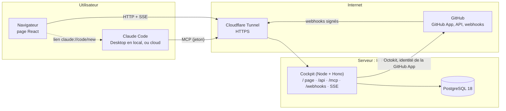

# Architecture de Cockpit

> L'état d'ensemble, à jour au **2026-10-29**. Il résume les décisions de [`decisions/`](decisions/), qui gardent le détail et le pourquoi de chaque choix. En cas de désaccord, c'est la décision la plus récente qui fait foi, et ce document doit être corrigé.

## En une phrase

Cockpit est un **service en ligne** : un seul serveur Node (Hono) sert la page React, l'API, le serveur MCP et les webhooks GitHub, et garde ses données dans **PostgreSQL**. Il **n'appelle jamais Claude** : ce sont les sessions Claude Code de chaque utilisateur qui viennent à lui par le MCP.

## Vue d'ensemble

- **Le navigateur** ouvre Claude Desktop sur le PC avec un lien `claude://code/new` ([005](decisions/005-lancement-local.md)). Cockpit ne voit jamais le PC.
- **Claude** s'identifie comme connecteur claude.ai, par OAuth ([006](decisions/006-connexion-oauth.md), [021](decisions/021-connecter-claude.md)), ou avec un jeton MCP créé à la main ([004](decisions/004-outils-mcp.md)).
- **GitHub** reste la source de vérité du code, des PR et de la CI. Cockpit n'en garde qu'une copie de cache, tenue à jour par les webhooks ([002](decisions/002-modele-donnees.md)).

## Les briques

| Brique | Choix | Décision |
|---|---|---|
| Langage | TypeScript strict, exécuté directement par Node (*type stripping*) | [001](decisions/001-stack.md) |
| Serveur | Node.js 24, Hono | [001](decisions/001-stack.md) |
| Base | **PostgreSQL 18**, pilote `pg`, Drizzle et drizzle-kit | [008](decisions/008-service-en-ligne.md) (remplace SQLite) |
| Validation | Zod, sur toutes les entrées | [001](decisions/001-stack.md) |
| Temps réel | SSE minimal : « tel objet a changé », puis rechargement par l'API | [001](decisions/001-stack.md) |
| Interface | React, Vite, React Router, TanStack Query, Tailwind v4, shadcn/ui | [001](decisions/001-stack.md), [003](decisions/003-interface.md) |
| GitHub | Une seule GitHub App, **créée par l'assistant de démarrage** à partir d'un manifeste ([012](decisions/012-configuration-automatique.md)), installée par chaque utilisateur ; connexion par son flux web, en `fetch` ; Octokit (`@octokit/app`) pour l'API des repos, avec l'identité de l'App seule (2.1) | [001](decisions/001-stack.md), [002](decisions/002-modele-donnees.md), [009](decisions/009-connexion-github.md), [011](decisions/011-import-projets.md) |
| Sessions | Cookie aléatoire de 30 jours, seule son empreinte SHA-256 en base ; aucun jeton GitHub de l'utilisateur gardé | [009](decisions/009-connexion-github.md) |
| MCP | SDK officiel (`@modelcontextprotocol/sdk`), transport HTTP en mode sans session et réponses JSON, à l'adresse `/mcp` ; jeton vérifié avant le SDK | [004](decisions/004-outils-mcp.md), [016](decisions/016-serveur-mcp.md) |
| OAuth | Cockpit est le serveur d'autorisation de son connecteur : métadonnées RFC 9728 et 8414, client reconnu par son document CIMD (`https://claude.ai/…` seulement), PKCE `S256`, code de 60 secondes en mémoire, jetons dans `mcp_tokens` (accès d'une heure, rafraîchissement de 90 jours remplacé sur la même ligne) | [006](decisions/006-connexion-oauth.md), [021](decisions/021-connecter-claude.md) |
| Tests | Vitest, Testing Library, **PGlite** (PostgreSQL en mémoire), faux GitHub | [001](decisions/001-stack.md), [008](decisions/008-service-en-ligne.md) |
| Qualité | Biome (lint et format), `tsc` ; la CI lance lint, typecheck, tests et build | [001](decisions/001-stack.md) |
| Exposition | Cloudflare Tunnel, sur le domaine de Dorian | [008](decisions/008-service-en-ligne.md) |
| Configuration | Une variable seulement, `DATABASE_URL` ; la GitHub App, son adresse publique et le premier administrateur viennent de l'assistant de démarrage, gardés dans la table `instance_settings` | [012](decisions/012-configuration-automatique.md) |
| Secrets de l'App | Secret OAuth, clé privée et secret des webhooks chiffrés en base (AES-256-GCM) ; la clé de chiffrement est générée au premier lancement dans un volume Docker à part (`secrets`) | [012](decisions/012-configuration-automatique.md) |

## Les règles qui tiennent l'architecture

Ce sont les points sur lesquels tout le reste s'appuie. Les changer, c'est revenir sur une décision.

1. **L'humain garde la main.** Valider, abandonner, merger : aucun outil MCP ne le permet. La table des droits est testée ligne par ligne ([004](decisions/004-outils-mcp.md)).
2. **Une seule fonction d'accès.** Tout objet remonte à son projet, et une seule fonction vérifie que l'utilisateur en est **membre** ([002](decisions/002-modele-donnees.md), [008](decisions/008-service-en-ligne.md)). Un objet d'un autre utilisateur répond « introuvable ».
3. **Une action métier = une transaction.** On vérifie le droit, on applique le changement et on écrit l'entrée d'historique **dans la même transaction**, ou rien n'est fait (tranche 1.4).
4. **Historique inaltérable.** Des triggers PostgreSQL refusent `UPDATE`, `DELETE` et `TRUNCATE`. Chez l'hébergeur, l'application n'aura en plus aucun droit d'écriture sur cette table hors `INSERT` ([008](decisions/008-service-en-ligne.md)).
5. **La base fait respecter ce qu'elle peut** : statuts par `CHECK`, un seul run actif par US par index unique conditionnel, un seul membre par projet au MVP par index unique ([002](decisions/002-modele-donnees.md)).
6. **On ne stocke pas ce qui se calcule** : l'étape d'un ticket, le Kanban, le verdict d'un run, le bilan de santé ([002](decisions/002-modele-donnees.md)).
7. **Aucun secret en clair** : jetons stockés par empreinte et affichés une seule fois ; secrets de la GitHub App chiffrés en base, avec une clé qui n'est jamais dans la base ni dans ses sauvegardes ([012](decisions/012-configuration-automatique.md)) ; aucune donnée personnelle en clair dans l'historique ([004](decisions/004-outils-mcp.md), [008](decisions/008-service-en-ligne.md)).
8. **Les erreurs se voient** : à l'écran, avec « Réessayer » ; au démarrage, le serveur refuse de partir sans `DATABASE_URL`.
9. **Les tests n'appellent jamais Claude ni le vrai GitHub** : routes testées avec `app.request()` sur PGlite, écrans avec un `fetch` simulé.

## Les données

Le modèle complet est dans la [002](decisions/002-modele-donnees.md), modifiée par la [008](decisions/008-service-en-ligne.md) :

| Domaine | Tables |
|---|---|
| Comptes | `users` (dont `is_admin` et `blocked_at`, 1.6), `sessions`, `mcp_tokens` (4.1 ; seule l'empreinte SHA-256 est stockée ; `history.token_id` depuis la 4.2 ; `client_id`, `refresh_hash`, `expires_at` et `refresh_expires_at` pour les connexions OAuth, 4.7) |
| Instance | `instance_settings` : une seule ligne, remplie par l'assistant de démarrage ([012](decisions/012-configuration-automatique.md)) |
| Projets | `projects` (un repo GitHub = un projet ; le planning de l'écriture des US et son dernier lancement, colonnes `routine_*`, 4.8), `project_members` |
| Routine d'écriture des US | `write_us_routines` (4.8) : une ligne par utilisateur, l'adresse de lancement et le jeton chiffré avec la clé de l'instance, jamais rendu par l'API |
| Travail | `tickets` (3.1 ; `history.ticket_id`, sans clé étrangère), `user_stories`, `acceptance_criteria`, `story_dependencies` (4.3 ; `history.story_id`, sans clé étrangère) |
| Développement | `runs`, `run_steps`, `questions` |
| Webhooks | `webhook_deliveries` (5.1) : les livraisons de GitHub, enregistrées avant tout traitement, sans doublon par `X-GitHub-Delivery`, purgées après 30 jours ; `processed_at`, `claimed_at` et `attempts` tiennent le traitement (5.2) |
| Trace | `history`, sans clé étrangère, inaltérable |
| Après le MVP | `code_maps`, `findings`, `code_sources` et les colonnes `kind`, `reasoning` et `object_names` pour l'analyse et la reprise ([007](decisions/007-reprise-app-existante.md))  |

Conventions : dates en `timestamptz`, JSON en `jsonb`, identifiants entiers `identity`, identifiants GitHub en `bigint`, valeurs fermées en texte avec `CHECK`. Les migrations sont générées par drizzle-kit, appliquées au démarrage, et ne sont jamais modifiées une fois appliquées.

## Déploiement

| | Phase 1 : le Pi | Phase 2 : un hébergeur |
|---|---|---|
| Quand | Dorian et des proches | Dès les premiers clients payants |
| Cockpit | Image Docker (Node, serveur, page construite) | La même image |
| PostgreSQL | Conteneur, données dans un volume | Service géré : sauvegarde continue, restauration à une date |
| Sauvegarde | `scripts/backup.sh` lancé chaque jour par cron : `pg_dump` compressé, 14 jours gardés | Fournie par l'hébergeur |
| Exposition | Cloudflare Tunnel (`cloudflared`), aucun port ouvert | Selon l'hébergeur |
| Mise en production | Workflow CD lancé à la main, runner sur le Pi, `scripts/deploy.sh` (refuse de partir sans ses secrets, vérifie la version servie) | À définir |
| Secrets | `/etc/cockpit/cockpit.env` sur le Pi (`TUNNEL_TOKEN` à saisir, `POSTGRES_PASSWORD` généré par `deploy.sh`), hors du repo : le checkout du CD efface les fichiers non suivis. La clé de chiffrement des secrets de la GitHub App vit dans le volume `secrets`, dont une copie est gardée hors du Pi | Gestion des secrets de l'hébergeur |

Le code ne contient rien de propre au Pi : tout passe par `DATABASE_URL`, `PORT` et `COCKPIT_KEY_FILE` (l'emplacement de la clé de chiffrement). Passer de la phase 1 à la phase 2, c'est déplacer l'image et la base.

## Montée en charge

- **La charge est faible par nature** : Cockpit ne fait tourner aucun modèle d'IA. Mille runs en parallèle représentent de l'ordre de cent écritures par seconde, ce qu'un seul serveur tient.
- **Une seule instance d'abord.** La règle : ce qui doit survivre à un redémarrage va en base. Cinq choses restent en mémoire et devront passer en base avant une deuxième instance : connexions SSE (par `LISTEN` / `NOTIFY`), codes d'autorisation OAuth et documents CIMD lus (021), sessions MCP (mode sans session) ([008](decisions/008-service-en-ligne.md)), et les créations de GitHub App en cours de l'assistant, valables une heure ([012](decisions/012-configuration-automatique.md)).
- **Webhooks : enregistrés d'abord, traités ensuite**, sans doublon grâce à `X-GitHub-Delivery` (5.1) ; traités juste après le 202 puis chaque minute, une livraison réservée à la fois (5.2).
- **La connexion à la base survit à un redémarrage de PostgreSQL** : le pool de connexions écoute ses erreurs au lieu de faire tomber le serveur (1.1 bis).

## Ce qui existe dans le code aujourd'hui

| Élément | État |
|---|---|
| Serveur Hono, route `/api/health`, page React servie par le serveur | Fait (1.1) |
| Table `users`, migrations appliquées au démarrage | Fait (1.1), passée à PostgreSQL en 1.1 bis |
| Tests serveur sur PGlite, tests d'écran, lint, typecheck, CI | Fait |
| Déploiement : `Dockerfile`, `compose.yaml` (app, PostgreSQL, tunnel), `scripts/deploy.sh`, `scripts/backup.sh` | Écrit et testé (1.2) ; premier déploiement réel sur le Pi à faire ; procédure dans le README, « Déployer sur le Pi » |
| Test de bout en bout du déploiement (`scripts/smoke-test.sh`, job `docker` de la CI) | Fait (1.2) |
| Connexion avec GitHub : `/api/auth/login`, `/callback`, `/logout`, `/api/me`, table `sessions`, inscription ouverte et comptes bloqués (en 1.6, la liste de comptes autorisés ayant été abandonnée) | Fait (1.3) |
| Historique inaltérable : table `history` (triggers qui refusent `UPDATE`, `DELETE`, `TRUNCATE`), fonction `act` (action + entrée dans une transaction), `/api/history`, page Journal | Fait (1.4) |
| Projets : importer un repo de l'installation de l'App, lister, archiver (`/api/github/repositories`, `/api/projects`), tables `projects` et `project_members`, page Projets | Fait (2.1) |
| Bilan de santé d'un projet, relu sur GitHub à chaque affichage et jamais stocké en base (cache en mémoire adressé par le commit) : `/api/projects/:id/health` (quatre lignes `claude_md`, `ci`, `mcp`, `agents` (code `invalid_team` si `.claude/team.md` est illisible, 028), plus la ligne `webhook` depuis la 5.1), page `/projets/:id` | Écrit et testé (2.2), en relecture |
| Assistant de démarrage : `/api/setup/status`, `/start`, `/callback` (code de démarrage, manifeste de la GitHub App, secrets chiffrés dans `instance_settings`, clé dans le volume `secrets`), premier administrateur, page « Installer Cockpit » ; plus aucune variable GitHub | Fait (1.5) |
| Accueil des utilisateurs : inscription ouverte, comptes bloqués (`users.blocked_at`), `/api/settings/users` (GET) et `/api/settings/users/:id/block` et `/unblock` (POST ; administrateur seulement), page « Réglages » ; `/api/installation` ; à la connexion, renvoi vers `/bienvenue` si l'App n'est pas installée, et bandeau « Installer » sur les autres pages | Écrit et testé (1.6) |
| Tickets : créer, lister, lire, modifier, supprimer (`/api/projects/:id/tickets`, `/api/tickets/:id`), table `tickets`, étape « Nouveau » calculée, description rendue en markdown sans HTML brut (`react-markdown`), section « Tickets » de `/projets/:id` et page `/tickets/:id` | Écrit et testé (3.1), en relecture |
| Jetons MCP : créer (secret `ckp_…` montré une fois, haché en base), lister, révoquer (`/api/me/tokens`, `/api/me/tokens/:id/revoke` ; chaque utilisateur, ses jetons seulement ; un jeton révoqué n'est plus listé, il est supprimé 3 mois plus tard par une purge quotidienne), table `mcp_tokens`, section « Jetons MCP » de « Réglages », désormais ouvert à tous (« Utilisateurs » reste à l'administrateur) | Écrit et testé (4.1), en relecture |
| Serveur MCP : `POST /mcp` (jeton `Bearer ckp_…` vérifié avant le SDK, refus journalisés en `mcp_auth`), outils `list_projects`, `get_project`, `search`, `get_ticket` et `create_ticket`, chaque appel journalisé par `act` (acteur `claude`, origine `mcp`, `history.token_id`) ; le Journal nomme ces actions et écrit « Claude » | Écrit et testé (4.2), en relecture |
| Claude écrit les US : tables `user_stories`, `acceptance_criteria`, `story_dependencies`, outils MCP `list_tickets_needing_us`, `create_user_stories` (tout ou rien par appel, écriture d'un gros ticket en plusieurs appels avec `more_to_come` et `stories_written` (le nombre d'US déjà écrites, sinon refus `writing_moved_on`) puis close par `tickets.stories_written_at`, au plus 100 US par ticket, ticket relu `FOR UPDATE`) et `get_user_story`, `search`, `get_ticket` et `get_project` étendus, étape du ticket calculée par `ticketStep(ticket, statuts des US)`, `GET /api/stories/:id`, suppression d'un ticket refusée s'il a des US (409 `ticket_has_stories`), page `/us/:id` en lecture seule, skill `/write-us` dans `catalog/skills/write-us/SKILL.md` | Écrit et testé (4.3), en relecture |
| Décisions humaines sur une US : routes `POST /api/stories/:id/validate`, `PATCH /api/stories/:id`, `POST /api/stories/:id/send-back` (commentaire obligatoire), `POST /api/stories/:id/abandon` et `POST /api/tickets/:id/abandon` (ses US non terminées passent `abandoned`), chacune dans un `act` après `assertActive`, l'US relue `FOR UPDATE` puis son statut vérifié (409 `wrong_status`, `project_archived`, `ticket_abandoned`), outil MCP `update_user_story` (seulement `to_rewrite` → `to_validate`), table des droits testée ligne par ligne (par ce qui n'existe pas), `GET /api/stories/:id/history` (une requête, entrées de l'utilisateur, sans les lectures), page `/us/:id` avec ses boutons et son historique replié, « Abandonner le ticket » sur `/tickets/:id`, skill `/write-us` qui réécrit | Écrit et testé (4.4), en relecture |
| Kanban par projet : `GET /api/projects/:id/stories` (une requête, les US non abandonnées avec le titre de leur ticket, sans entrée d'historique), section « Kanban » de `/projets/:id` au-dessus des tickets (cinq colonnes À valider / Prêtes / En cours / En revue / Terminées, cartes-liens vers `/us/:id`, sans bouton ni glisser-déposer), requête `["stories", projet]` invalidée par les décisions sur une US, l'abandon et le renommage d'un ticket | Écrit et testé (4.5), en relecture |
| Publication en issue GitHub : à la validation, l'US devient une issue (`renderIssue`, fonction pure : titre, corps en cases à cocher, label `cockpit: …`, ouverte ou fermée selon le statut), synchronisée par `syncIssue` **après** la transaction de la décision (validation, modification, abandon d'une US, abandon d'un ticket) et jamais dedans ; création réservée par `issue_claimed_at`, écritures de `githubClient` avec l'installation, `issue_number` et `issue_body_hash` sur l'US, une entrée `sync_issue` par synchronisation (`github_effects`, `error` sans message GitHub), `story.issue` avec `upToDate`, `POST /api/stories/:id/publish`, « Issue #N » et « Republier » sur `/us/:id` | Écrit et testé (4.6), en relecture |
| Connecter Claude : `GET /.well-known/oauth-protected-resource` (et `/mcp`) et `/oauth-authorization-server`, `WWW-Authenticate` sur le 401 de `/mcp`, `GET /oauth/authorize` (demande vérifiée, document CIMD lu en 5 s et 64 Kio, gardé 10 minutes), page `/autoriser` (`GET /api/oauth/request`, `POST /api/oauth/approve`), `POST /oauth/token` (`authorization_code` avec PKCE, `refresh_token` avec rotation sur la même ligne, erreurs RFC 6749), `GET /api/me/connect`, `kind` (`oauth` ou `manual`) sur les jetons listés, `/api/auth/login?next=` limité aux chemins `/autoriser`, entrées `oauth_authorize` et `oauth_token`, section « Connecter Claude » de « Réglages », ligne MCP du bilan de santé verte quand Cockpit est absent du `.mcp.json` | Écrit et testé (4.7), en relecture |
| Programmer l'écriture des US : `GET`, `PUT` et `DELETE /api/me/routine` (adresse `https://api.anthropic.com/v1/claude_code/routines/<id>/fire` vérifiée, jeton chiffré, jamais rendu), `GET` et `PUT /api/projects/:id/routine` (désactivée, à la demande, chaque jour, chaque semaine, heure du fuseau du navigateur, prochain passage cherché par quart d'heure, sur 15 jours avec `Intl.DateTimeFormat`), `POST /api/projects/:id/routine/run` (409 `routine_not_connected`, `routine_needs_reconnect`, `project_archived` ; 502 `fire_failed`), `runDueRoutines` toutes les minutes (`scheduleRoutines`, projet réservé par un `UPDATE` qui avance le prochain passage, rien lancé sans US à écrire ni sur un projet archivé, 401, 403 ou 404 de `/fire` : « à reconnecter »), entrées `connect_routine`, `disconnect_routine`, `schedule_routine`, `fire_write_us`, sections « Écrire les US automatiquement » de « Réglages » et « Écriture automatique des US » de `/projets/:id` | Écrit et testé (4.8), en relecture |
| Réglages en onglets et adresse publique en https : `CF-Visitor` lu avant `X-Forwarded-Proto` par l'assistant, `https://` exigé (sauf `localhost`, `127.0.0.1`, `[::1]`), ~~`GET` et `PUT /api/settings/public-url`~~ (retirés par 028), entrée `change_public_url` (`args: {}`, libellé gardé dans le Journal), onglets de Réglages (quatre, par 028), ~~section « Adresse publique »~~ (retirée par 028) | Écrit et testé (023), en relecture |
| Recevoir les webhooks : `POST /api/webhooks/github` (sans session, 503 si l'instance n'est pas configurée ; exemptée de la limite de 256 Kio de `/api/*` : sa limite est de 25 Mio, 413 au-delà ; signature `X-Hub-Signature-256` vérifiée en temps constant sur le corps brut avant tout, 401 sinon ; 400 si les en-têtes ou le corps sont invalides), table `webhook_deliveries` (clé `X-GitHub-Delivery`, `processed_at` vide : rien n'est encore traité), insérée avec l'entrée `receive_webhook` (acteur `github`, origine `webhook`, projet et propriétaire du repo suivi) dans une transaction, purgée après 30 jours par la purge quotidienne ; `GET /api/history` ajoute `event` à ces entrées ; cinquième ligne `webhook` du bilan (`GET /app/hook/config` et `/app/hook/deliveries?per_page=1` lus comme l'App, gardés une minute en mémoire hors du cache par commit ; `wrong_url`, `last_delivery_failed`, `unknown`) ; le changement d'adresse du webhook (`PATCH /app/hook/config`, `PUT /api/settings/public-url`) est retiré par 028 | Écrit et testé (5.1), en relecture |
| Une issue modifiée sur GitHub : `processDeliveries` (une livraison réservée par un `UPDATE` atomique sur `claimed_at`, traitée selon `event` et `action`, `processed_at` rempli ; un échec compte une tentative, la cinquième marque la livraison traitée avec l'entrée `process_webhook`), lancé après le 202 et par `scheduleDeliveries` chaque minute ; `issues.edited` hors de l'App comparé à `renderIssue` (fins de ligne CRLF de l'éditeur web ramenées à LF), version de GitHub gardée sur l'US (`issue_github_title`, `issue_github_body`, `issue_diverged_at`) et entrée `issue_diverged` ; la synchronisation n'écrit plus sur GitHub tant que l'écart dure ; `story.issue.diverged`, `issueDiverged` sur les cartes du Kanban ; `parseIssue` (inverse de `renderIssue`), `POST /api/stories/:id/issue/keep-cockpit` et `/take-github` (409 `no_divergence`, `not_template`), entrées `keep_cockpit_issue` et `take_github_issue` ; `diffLines` (plus longue sous-suite commune, repli au-delà de 2 000 lignes), section « Issue modifiée sur GitHub » de `/us/:id` | Écrit et testé (5.2), en relecture |
| Écrire dans un repo sans rien écraser, sans écran ni route : `planRepoWrite` (branche par défaut et son commit, puis, pour chaque fichier, l'arbre Git de son dossier et de ses parents à ce commit : `create`, `same` ou `exists` (avec le contenu actuel, ou sans pour un dossier, un lien, un sous-module, un fichier trop gros ou un parent qui n'est pas un vrai dossier), jamais écrasé ; chemins et tailles validés, une exception sinon) et `applyRepoWrite` (un seul commit par l'API Git : arbre sur `base_tree`, commit, branche avancée avec `force: false` ; les fichiers à créer sont relus au commit de la branche, sauf si le plan est signé (HMAC, clé tirée au démarrage) et la branche inchangée ; chaque arbre n'est lu qu'une fois par appel ; branche par défaut protégée : branche `cockpit/<7>` et pull request ouverte, `pullRequest` dans le résultat) du client GitHub ; refus rendus, jamais levés : `empty_repo`, `repo_unreachable`, `repo_changed`, `pull_request_forbidden` ; rien n'est écrit ni appelé quand aucun fichier n'est à créer | Écrit et testé (6.1), en relecture |
| Préparer un repo pour Claude : `POST /api/projects/:id/prepare` (lit le plan de 026 pour les fichiers de `catalog/` : trois agents, les skills `/dev-us` et `/write-us`, et un `CLAUDE.md` de départ que `unlessExists` laisse hors du plan quand `CLAUDE.md` ou `.claude/CLAUDE.md` existe ; n'écrit rien dans l'historique) et `POST /api/projects/:id/prepare/apply` (`{ plan }`, un commit « feat: prepare the repo for Claude (Cockpit) » ; un plan mal formé ou un chemin refusé par 026 D : 400 ; les refus de 026 : 409 avec leur code, `pull_request_forbidden` avec `appSettingsUrl` ; une erreur de GitHub : 502) ; entrée `prepare_repo` (`args: { created }`, `github_effects: { commitSha, pullRequest }`) ; bouton « Préparer pour Claude » et liste des fichiers dans le bilan de santé de `/projets/:id` ; le `Dockerfile` copie `catalog/` | Écrit et testé (6.2), en relecture |
| Éditeur d'agent (030) : `GET /api/projects/:id/agents` (`{ agents, catalog }`, n'écrit rien dans l'historique) et `POST /api/projects/:id/agents/apply` (`{ name, before, after }`, un commit « feat: add / update / remove the agent <nom> (Cockpit) » via `applyRepoChanges` du client GitHub, refus `repo_changed` si le fichier n'est plus `before` ; limite de corps de 4 Mio pour cette route seule) ; entrées `save_agent` et `delete_agent` (`args: { path }`, `github_effects: { commitSha, pullRequest }`) ; cinquième onglet « Agents » (`/projets/:id/agents`) | Écrit et testé (E2) |
| L'équipe en graphe (031) : `GET /api/projects/:id/agents` rend en plus `team` (texte de `.claude/team.md`, `null` sans fichier) et `POST /api/projects/:id/team/apply` (`{ before, after }`, un commit « feat: update the team (Cockpit) » via `applyRepoChanges`, comme `agents/apply` dont il partage le corps ; `after` refusé en 400 s'il n'est pas lu par `parseTeam` ou dépasse 1 Mio ; même limite de corps de 4 Mio) ; entrée `save_team` (`args: { path }`, `github_effects`) ; section « Équipe » de l'onglet « Agents » : graphe de cartes (dépendance `@xyflow/react` 12.12.0, thémée par les jetons de `styles.css`, masqué en largeur téléphone), liste des étapes, panneau, diff et commit ; lecture et écriture du fichier dans `src/web/team-file.ts` | Écrit et testé (E3) |
| Plusieurs équipes par projet (032) : `.claude/teams/<nom>.md` (nom au format d'un agent, 238 caractères au plus pour tenir en 255) ; `GET /api/projects/:id/agents` rend en plus `teams: [{ name, text }]` (`""` pour une entrée illisible) ; `POST /api/projects/:id/team/apply` prend un `name` optionnel (`after: null` seulement avec un nom : suppression, commit « feat: remove the team <nom> (Cockpit) ») ; entrées `save_team` et `delete_team` (`args: { path }`) ; la ligne `agents` du bilan vérifie aussi chaque équipe nommée (lue une fois, dans la vague de `team.md`) ; liste « Équipe » dans la section du même nom ; `/dev-us <US> --team <nom>` dans le skill du catalogue | Écrit et testé (E4) |
| Le run minimal (033) : tables `runs` et `run_steps` (index unique sur `story_id` où `status = 'running'`), colonnes `user_stories.branch` et `history.run_id` ; outils MCP `start_run`, `report_step`, `finish_run` ; `get_user_story` rend `branch` et `active_run_id` ; `GET /api/runs/:id`, `runs` dans `GET /api/stories/:id` ; `GET /api/events` (SSE `change`, `run:<id>` et `story:<id>`, abonnés en mémoire, après la transaction, vers les membres du projet) ; page `/runs/:id`, liste des runs sur la page de l'US, libellés du Journal ; `/dev-us` rend compte de son run | Écrit et testé (7.1) |
| La fenêtre « Développer avec Claude » (034) : `GET /api/projects/:id/branches` (`{ branches }`, première page de GitHub lue comme l'App, rien dans l'historique), `story.branch` dans `GET /api/stories/:id`, panneau de `/us/:id` (`DevelopWindow.tsx`) qui compose le lien `claude://code/new?folder=…&q=…` ; `/dev-us` passe le prompt complémentaire à `start_run` en `comment` | Écrit et testé (7.2) |
| Critères et PR (035) : `report_criterion` (résultat et preuve sur le critère, avec le run), `link_pull_request` (PR lue sur GitHub comme l'App, US `in_review`, `pr_number`), `finish_run` `succeeded` refusé sans PR ; résultats dans `get_user_story`, `GET /api/stories/:id` et `GET /api/runs/:id`, section « Critères » du run, lien « PR n° » de l'US | Écrit et testé (7.3) |
| Style Crème sombre, onglets, journal par pages, plus d'adresse publique : jetons de `styles.css` (Geist et Geist Mono), barre du haut (logo, Navigation principale, lien « Réglages », avatar), `GET /api/history` par 25 entrées (`{ entries, hasMore }`, `?before=<id>` sur le couple `at`, `id`, 400 `invalid_cursor`) et « Afficher plus » dans le Journal, page d'un projet en onglets (`/projets/:id`, `/tickets`, `/sante`, `/ecriture-us`, plus `/agents` depuis 030), Réglages en quatre onglets (`/reglages`, `/jetons`, `/utilisateurs`, `/ecriture-us`), `GET` et `PUT /api/settings/public-url` supprimés, l'assistant d'installation détecte l'adresse lui-même (`POST /api/setup/start` ne reçoit que `{ code }`, 400 si elle n'est pas en https, sauf boucle locale) (J) | Écrit et testé (028), en relecture |
| Tout le reste (runs, traitements des webhooks…) | À faire, dans l'ordre du [découpage](decoupage.md) |

## Index des décisions

| # | Sujet | Statut | En bref |
|---|---|---|---|
| [001](decisions/001-stack.md) | Stack technique | Validée, modifiée par 008 | Node, Hono, React, Drizzle, Zod, SSE |
| [002](decisions/002-modele-donnees.md) | Modèle de données | Validée, modifiée par 008 | Tables du MVP, ce qui se calcule, historique |
| [003](decisions/003-interface.md) | Interface | Validée | « Qui doit agir ? », règles d'ergonomie, style |
| [004](decisions/004-outils-mcp.md) | Outils MCP | Validée | Ce que Claude peut faire, et ce qu'aucun outil ne fait |
| [005](decisions/005-lancement-local.md) | Lancement local | Validée | `claude://code/new`, modèle choisi par la fiche de chaque agent |
| [006](decisions/006-connexion-oauth.md) | Connexion OAuth | Validée | Cockpit comme connecteur claude.ai, après le MVP |
| [007](decisions/007-reprise-app-existante.md) | Analyser et reprendre une app existante | Proposée | La fonctionnalité phare : carte du modèle par sous-projet, règles et constats (bugs, failles, architecture, stack, versions) déposés par Claude en citant le code vérifié ; règles validées en regard du code, constats triés en tickets |
| [008](decisions/008-service-en-ligne.md) | Service en ligne | Proposée | PostgreSQL, membres d'un projet, le Pi puis un hébergeur |
| [009](decisions/009-connexion-github.md) | Connexion avec GitHub | Proposée | Flux web de la GitHub App, cookie de session, inscription ouverte et comptes bloqués (depuis la 012) |
| [010](decisions/010-historique.md) | Historique inaltérable | Proposée | Triggers, `act` (une action = une transaction), pas de donnée personnelle dans les `args`, page Journal |
| [011](decisions/011-import-projets.md) | Importer et archiver un projet | Proposée | Repos lus avec l'identité de l'App, rien cru du navigateur, une seule fonction d'accès, archivage sans désarchivage |
| [012](decisions/012-configuration-automatique.md) | Configuration automatique | Proposée | Assistant de démarrage qui crée la GitHub App, secrets chiffrés en base, administrateur, mot de passe de la base généré |
| [013](decisions/013-bilan-de-sante.md) | Bilan de santé d'un projet | Proposée | Quatre règles à codes fixes, relues sur GitHub à chaque affichage (cache en mémoire adressé par le commit, rien en base), corrections en 6.2 |
| [014](decisions/014-tickets.md) | Les tickets | Proposée | Titre et description markdown, projet archivé en lecture seule, étape calculée (« Nouveau » tant qu'il n'y a pas d'US), `args` de l'historique sans texte, markdown sans HTML brut |
| [015](decisions/015-jetons-mcp.md) | Les jetons MCP | Proposée | `ckp_` + 43 caractères, seule l'empreinte SHA-256 en base, montré une fois, 20 actifs par utilisateur, personnels (l'administrateur n'y touche pas), « Réglages » ouvert à tous |
| [016](decisions/016-serveur-mcp.md) | Le serveur MCP | Proposée | SDK officiel en mode sans session et réponses JSON, jeton vérifié avant le SDK (401 et `mcp_auth`), cinq outils, refus et erreurs lus par Claude, `args` de l'historique réduits à des identifiants (règle 010 D, qui modifie la 004) |
| [017](decisions/017-user-stories.md) | Claude écrit les user stories | Proposée | Trois tables, `create_user_stories` tout ou rien par appel, en plusieurs appels pour un gros ticket (`more_to_come`), `list_tickets_needing_us` et `get_user_story`, étape du ticket calculée avec ses US, page d'une US en lecture seule, skill `/write-us` (règles F et G de la 014 modifiées) |
| [018](decisions/018-decisions-humaines.md) | Les décisions humaines sur une US | Proposée | Valider, modifier, renvoyer (commentaire obligatoire), abandonner une US et abandonner un ticket, `update_user_story` pour Claude, table des droits testée ligne par ligne, historique de l'US, chaque action relit l'US `FOR UPDATE` (modifie la table des droits de la 004) |
| [019](decisions/019-kanban.md) | Le Kanban d'un projet | Proposée | `GET /api/projects/:id/stories` (US non abandonnées, ticket puis position), cinq colonnes calculées par statut, cartes-liens sans bouton, section au-dessus des tickets, invalidée par les décisions (018), l'abandon et le renommage d'un ticket |
| [020](decisions/020-issues-github.md) | La publication d'une US en issue GitHub | Proposée | Issue créée à la validation et tenue à jour jusqu'au bout, gabarit unique (fonction pure), un label de statut `cockpit: …`, ouverte puis fermée, synchronisation hors transaction avec réservation de la création, `issue_body_hash` pour savoir si elle est à jour, entrée `sync_issue` (`github_effects`), « Republier » |
| [021](decisions/021-connecter-claude.md) | Connecter Claude à Cockpit | Proposée | Met en œuvre la 006 avant les webhooks : connecteur claude.ai, clients `https://claude.ai/…` par CIMD, consentement derrière la connexion GitHub, jetons OAuth dans `mcp_tokens`, section « Connecter Claude » en trois étapes, Cockpit absent du `.mcp.json` accepté |
| [022](decisions/022-routine-ecriture-us.md) | Programmer l'écriture des US depuis Cockpit | Proposée | Une tâche planifiée par utilisateur créée sur claude.ai (consigne fournie), Cockpit tient le planning par projet et appelle son `/fire` (adresse vérifiée, jeton chiffré), rien lancé sans US à écrire, 401, 403 ou 404 : « à reconnecter » |
| [023](decisions/023-reglages-adresse-https.md) | Réglages en onglets, adresse publique en https | Proposée | `CF-Visitor` pour détecter l'adresse, `https://` exigé (sauf boucle locale), ~~adresse modifiable par l'administrateur dans Réglages~~ (retirée par 028), ~~onglets « Général » et « Écriture automatique des US »~~ (quatre onglets, 028), partie repliée « Connecter Claude depuis le CLI Claude Code » |
| [024](decisions/024-webhooks.md) | Recevoir les webhooks GitHub | Proposée | Signature vérifiée sur le corps brut, livraison enregistrée (`webhook_deliveries`, sans doublon par `X-GitHub-Delivery`) avant de répondre 202, entrée `receive_webhook`, traitement repoussé à la 5.2, ligne `webhook` du bilan lue sur l'App (adresse et dernière livraison, gardée une minute), ~~adresse du webhook changée avec l'adresse publique~~ (retirée par 028) |
| [025](decisions/025-issue-modifiee-sur-github.md) | Une issue modifiée sur GitHub | Proposée | Livraisons traitées (réservées, reprises chaque minute, abandonnées à la cinquième tentative), `issues.edited` hors App comparé au rendu, version de GitHub gardée sur l'US et synchronisation suspendue, diff ligne à ligne, « Garder la version de Cockpit » ou « Reprendre la version de GitHub » (gabarit relu, `not_template` sinon) |
| [026](decisions/026-ecrire-dans-un-repo.md) | Écrire dans un repo sans rien écraser | Proposée | `planRepoWrite` (créer, déjà là, existe autrement : jamais écrasé) puis `applyRepoWrite` en un commit par l'API Git, branche avancée sans forcer, relecture de chaque fichier à créer avant d'écrire (`repo_changed`) sauf plan signé et branche inchangée (H), une lecture par arbre et par appel (H), pull request si la branche par défaut est protégée (G, Pull requests en écriture : 012 D modifiée), refus `empty_repo`, `repo_unreachable`, `pull_request_forbidden` |
| [027](decisions/027-preparer-pour-claude.md) | Préparer un repo pour Claude en un clic | Proposée | Catalogue (`test-writer`, `developer`, `reviewer`, `/dev-us`, `/write-us`, `CLAUDE.md` de départ si aucun), plan montré fichier par fichier puis un commit (ou une PR si la branche est protégée), entrée `prepare_repo`, bouton dans le bilan de santé |
| [028](decisions/028-creme-sombre-onglets-journal.md) | Style Crème sombre, onglets, journal par pages, plus d'adresse publique dans Réglages | Proposée | Jetons de `styles.css` et Geist, barre du haut, journal de 25 entrées avec « Afficher plus » (`?before=<id>`), onglets du projet et de Réglages, plus de `public-url` (023 C et E, 024 G modifiés) |
| [029](decisions/029-equipe-d-agents.md) | Une équipe d'agents configurable par projet | Proposée | `.claude/team.md` (étapes ordonnées, boucle possible) lu par `/dev-us` avec trois étapes par défaut, éditeur d'agent et écran « Équipe » (un commit, diff avant), règle F de la 013 modifiée (`invalid_team`), plusieurs équipes plus tard, le Leader est la session principale |
| [Offres](offres.md) | Gratuit, Pro, Entreprise | Notes, rien de décidé | Idées de prix et de quotas |

## Points ouverts

| Sujet | Où |
|---|---|
| Permissions ajoutées après le MVP : modification manuelle de l'App et approbation de chaque utilisateur | [012](decisions/012-configuration-automatique.md) |
| Relancer une US en revue quand la CI échoue après la PR | [004](decisions/004-outils-mcp.md), tranche 7.5 |
| Cloudflare ne doit bloquer ni les adresses d'Anthropic ni les webhooks | [006](decisions/006-connexion-oauth.md), tranche 1.2 |
| Repo déjà suivi par un autre compte : refus qui révèle l'existence du projet | [008](decisions/008-service-en-ligne.md), tranche 2.1 |
| Choix de l'hébergeur ; facturation par personne ou par organisation | [008](decisions/008-service-en-ligne.md), [offres](offres.md) |
| Écrans restants et version téléphone | [003](decisions/003-interface.md) |
| Granularité des règles et contrôle du mode « figer l'existant » | [007](decisions/007-reprise-app-existante.md) |
| Trois permissions de plus sur la GitHub App pour lire les alertes de sécurité (tranche R6) | [007](decisions/007-reprise-app-existante.md), [012](decisions/012-configuration-automatique.md) |
| Analyse et reprise dans l'offre Pro, bloquées côté serveur | [007](decisions/007-reprise-app-existante.md), [offres](offres.md) |
