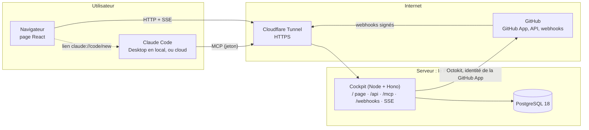

# Architecture de Cockpit

> L'état d'ensemble, à jour au **2026-10-23**. Il résume les décisions de [`decisions/`](decisions/), qui gardent le détail et le pourquoi de chaque choix. En cas de désaccord, c'est la décision la plus récente qui fait foi, et ce document doit être corrigé.

## En une phrase

Cockpit est un **service en ligne** : un seul serveur Node (Hono) sert la page React, l'API, le serveur MCP et les webhooks GitHub, et garde ses données dans **PostgreSQL**. Il **n'appelle jamais Claude** : ce sont les sessions Claude Code de chaque utilisateur qui viennent à lui par le MCP.

## Vue d'ensemble

- **Le navigateur** ouvre Claude Desktop sur le PC avec un lien `claude://code/new` ([005](decisions/005-lancement-local.md)). Cockpit ne voit jamais le PC.
- **Claude Code** s'identifie avec un jeton MCP ([004](decisions/004-outils-mcp.md)), et plus tard par OAuth, comme connecteur claude.ai ([006](decisions/006-connexion-oauth.md)).
- **GitHub** reste la source de vérité du code, des PR et de la CI. Cockpit n'en garde qu'une copie de cache, tenue à jour par les webhooks ([002](decisions/002-modele-donnees.md)).

## Les briques

| Brique | Choix | Décision |
|---|---|---|
| Langage | TypeScript strict, exécuté directement par Node (*type stripping*) | [001](decisions/001-stack.md) |
| Serveur | Node.js 24, Hono | [001](decisions/001-stack.md) |
| Base | **PostgreSQL 18**, pilote `pg`, Drizzle et drizzle-kit | [008](decisions/008-service-en-ligne.md) (remplace SQLite) |
| Validation | Zod, sur toutes les entrées | [001](decisions/001-stack.md) |
| Temps réel | SSE minimal : « tel objet a changé », puis rechargement par l'API | [001](decisions/001-stack.md) |
| Interface | React, Vite, React Router, TanStack Query, Tailwind v4, shadcn/ui | [001](decisions/001-stack.md), [003](decisions/003-interface.md) |
| GitHub | Une seule GitHub App, **créée par l'assistant de démarrage** à partir d'un manifeste ([012](decisions/012-configuration-automatique.md)), installée par chaque utilisateur ; connexion par son flux web, en `fetch` ; Octokit (`@octokit/app`) pour l'API des repos, avec l'identité de l'App seule (2.1) | [001](decisions/001-stack.md), [002](decisions/002-modele-donnees.md), [009](decisions/009-connexion-github.md), [011](decisions/011-import-projets.md) |
| Sessions | Cookie aléatoire de 30 jours, seule son empreinte SHA-256 en base ; aucun jeton GitHub de l'utilisateur gardé | [009](decisions/009-connexion-github.md) |
| MCP | SDK officiel, transport HTTP, à l'adresse `/mcp` | [004](decisions/004-outils-mcp.md) |
| Tests | Vitest, Testing Library, **PGlite** (PostgreSQL en mémoire), faux GitHub | [001](decisions/001-stack.md), [008](decisions/008-service-en-ligne.md) |
| Qualité | Biome (lint et format), `tsc` ; la CI lance lint, typecheck, tests et build | [001](decisions/001-stack.md) |
| Exposition | Cloudflare Tunnel, sur le domaine de Dorian | [008](decisions/008-service-en-ligne.md) |
| Configuration | Une variable seulement, `DATABASE_URL` ; la GitHub App, son adresse publique et le premier administrateur viennent de l'assistant de démarrage, gardés dans la table `instance_settings` | [012](decisions/012-configuration-automatique.md) |
| Secrets de l'App | Secret OAuth, clé privée et secret des webhooks chiffrés en base (AES-256-GCM) ; la clé de chiffrement est générée au premier lancement dans un volume Docker à part (`secrets`) | [012](decisions/012-configuration-automatique.md) |

## Les règles qui tiennent l'architecture

Ce sont les points sur lesquels tout le reste s'appuie. Les changer, c'est revenir sur une décision.

1. **L'humain garde la main.** Valider, abandonner, merger : aucun outil MCP ne le permet. La table des droits est testée ligne par ligne ([004](decisions/004-outils-mcp.md)).
2. **Une seule fonction d'accès.** Tout objet remonte à son projet, et une seule fonction vérifie que l'utilisateur en est **membre** ([002](decisions/002-modele-donnees.md), [008](decisions/008-service-en-ligne.md)). Un objet d'un autre utilisateur répond « introuvable ».
3. **Une action métier = une transaction.** On vérifie le droit, on applique le changement et on écrit l'entrée d'historique **dans la même transaction**, ou rien n'est fait (tranche 1.4).
4. **Historique inaltérable.** Des triggers PostgreSQL refusent `UPDATE`, `DELETE` et `TRUNCATE`. Chez l'hébergeur, l'application n'aura en plus aucun droit d'écriture sur cette table hors `INSERT` ([008](decisions/008-service-en-ligne.md)).
5. **La base fait respecter ce qu'elle peut** : statuts par `CHECK`, un seul run actif par US par index unique conditionnel, un seul membre par projet au MVP par index unique ([002](decisions/002-modele-donnees.md)).
6. **On ne stocke pas ce qui se calcule** : l'étape d'un ticket, le Kanban, le verdict d'un run, le bilan de santé ([002](decisions/002-modele-donnees.md)).
7. **Aucun secret en clair** : jetons stockés par empreinte et affichés une seule fois ; secrets de la GitHub App chiffrés en base, avec une clé qui n'est jamais dans la base ni dans ses sauvegardes ([012](decisions/012-configuration-automatique.md)) ; aucune donnée personnelle en clair dans l'historique ([004](decisions/004-outils-mcp.md), [008](decisions/008-service-en-ligne.md)).
8. **Les erreurs se voient** : à l'écran, avec « Réessayer » ; au démarrage, le serveur refuse de partir sans `DATABASE_URL`.
9. **Les tests n'appellent jamais Claude ni le vrai GitHub** : routes testées avec `app.request()` sur PGlite, écrans avec un `fetch` simulé.

## Les données

Le modèle complet est dans la [002](decisions/002-modele-donnees.md), modifiée par la [008](decisions/008-service-en-ligne.md) :

| Domaine | Tables |
|---|---|
| Comptes | `users` (dont `is_admin`), `sessions`, `mcp_tokens` |
| Instance | `instance_settings` : une seule ligne, remplie par l'assistant de démarrage ([012](decisions/012-configuration-automatique.md)) |
| Projets | `projects` (un repo GitHub = un projet), `project_members` |
| Travail | `tickets`, `user_stories`, `acceptance_criteria`, `story_dependencies` |
| Développement | `runs`, `run_steps`, `questions` |
| Trace | `history`, sans clé étrangère, inaltérable |
| Après le MVP | `criterion_sources` et les colonnes `kind` et `reasoning` pour la reprise ([007](decisions/007-reprise-app-existante.md)) ; colonnes OAuth sur `mcp_tokens` ([006](decisions/006-connexion-oauth.md)) ; livraisons de webhooks enregistrées (5.1) |

Conventions : dates en `timestamptz`, JSON en `jsonb`, identifiants entiers `identity`, identifiants GitHub en `bigint`, valeurs fermées en texte avec `CHECK`. Les migrations sont générées par drizzle-kit, appliquées au démarrage, et ne sont jamais modifiées une fois appliquées.

## Déploiement

| | Phase 1 : le Pi | Phase 2 : un hébergeur |
|---|---|---|
| Quand | Dorian et des proches | Dès les premiers clients payants |
| Cockpit | Image Docker (Node, serveur, page construite) | La même image |
| PostgreSQL | Conteneur, données dans un volume | Service géré : sauvegarde continue, restauration à une date |
| Sauvegarde | `scripts/backup.sh` lancé chaque jour par cron : `pg_dump` compressé, 14 jours gardés | Fournie par l'hébergeur |
| Exposition | Cloudflare Tunnel (`cloudflared`), aucun port ouvert | Selon l'hébergeur |
| Mise en production | Workflow CD lancé à la main, runner sur le Pi, `scripts/deploy.sh` (refuse de partir sans ses secrets, vérifie la version servie) | À définir |
| Secrets | `/etc/cockpit/cockpit.env` sur le Pi (`TUNNEL_TOKEN` à saisir, `POSTGRES_PASSWORD` généré par `deploy.sh`), hors du repo : le checkout du CD efface les fichiers non suivis. La clé de chiffrement des secrets de la GitHub App vit dans le volume `secrets`, dont une copie est gardée hors du Pi | Gestion des secrets de l'hébergeur |

Le code ne contient rien de propre au Pi : tout passe par `DATABASE_URL`, `PORT` et `COCKPIT_KEY_FILE` (l'emplacement de la clé de chiffrement). Passer de la phase 1 à la phase 2, c'est déplacer l'image et la base.

## Montée en charge

- **La charge est faible par nature** : Cockpit ne fait tourner aucun modèle d'IA. Mille runs en parallèle représentent de l'ordre de cent écritures par seconde, ce qu'un seul serveur tient.
- **Une seule instance d'abord.** La règle : ce qui doit survivre à un redémarrage va en base. Quatre choses restent en mémoire et devront passer en base avant une deuxième instance : connexions SSE (par `LISTEN` / `NOTIFY`), codes OAuth, sessions MCP (mode sans session) ([008](decisions/008-service-en-ligne.md)), et les créations de GitHub App en cours de l'assistant, valables une heure ([012](decisions/012-configuration-automatique.md)).
- **Webhooks : enregistrés d'abord, traités ensuite**, sans doublon grâce à `X-GitHub-Delivery` (5.1).
- **La connexion à la base survit à un redémarrage de PostgreSQL** : le pool de connexions écoute ses erreurs au lieu de faire tomber le serveur (1.1 bis).

## Ce qui existe dans le code aujourd'hui

| Élément | État |
|---|---|
| Serveur Hono, route `/api/health`, page React servie par le serveur | Fait (1.1) |
| Table `users`, migrations appliquées au démarrage | Fait (1.1), passée à PostgreSQL en 1.1 bis |
| Tests serveur sur PGlite, tests d'écran, lint, typecheck, CI | Fait |
| Déploiement : `Dockerfile`, `compose.yaml` (app, PostgreSQL, tunnel), `scripts/deploy.sh`, `scripts/backup.sh` | Écrit et testé (1.2) ; premier déploiement réel sur le Pi à faire ; procédure dans le README, « Déployer sur le Pi » |
| Test de bout en bout du déploiement (`scripts/smoke-test.sh`, job `docker` de la CI) | Fait (1.2) |
| Connexion avec GitHub : `/api/auth/login`, `/callback`, `/logout`, `/api/me`, table `sessions`, liste des comptes autorisés | Fait (1.3) |
| Historique inaltérable : table `history` (triggers qui refusent `UPDATE`, `DELETE`, `TRUNCATE`), fonction `act` (action + entrée dans une transaction), `/api/history`, page Journal | Fait (1.4) |
| Projets : importer un repo de l'installation de l'App, lister, archiver (`/api/github/repositories`, `/api/projects`), tables `projects` et `project_members`, page Projets | Fait (2.1) |
| Assistant de démarrage : `/api/setup/status`, `/start`, `/callback` (code de démarrage, manifeste de la GitHub App, secrets chiffrés dans `instance_settings`, clé dans le volume `secrets`), premier administrateur, page « Installer Cockpit » ; plus aucune variable GitHub | Fait (1.5) |
| Tout le reste (tickets, MCP…) | À faire, dans l'ordre du [découpage](decoupage.md) |

## Index des décisions

| # | Sujet | Statut | En bref |
|---|---|---|---|
| [001](decisions/001-stack.md) | Stack technique | Validée, modifiée par 008 | Node, Hono, React, Drizzle, Zod, SSE |
| [002](decisions/002-modele-donnees.md) | Modèle de données | Validée, modifiée par 008 | Tables du MVP, ce qui se calcule, historique |
| [003](decisions/003-interface.md) | Interface | Validée | « Qui doit agir ? », règles d'ergonomie, style |
| [004](decisions/004-outils-mcp.md) | Outils MCP | Validée | Ce que Claude peut faire, et ce qu'aucun outil ne fait |
| [005](decisions/005-lancement-local.md) | Lancement local | Validée | `claude://code/new`, modèle choisi par la fiche de chaque agent |
| [006](decisions/006-connexion-oauth.md) | Connexion OAuth | Validée | Cockpit comme connecteur claude.ai, après le MVP |
| [007](decisions/007-reprise-app-existante.md) | Reprendre une app existante | Proposée | La fonctionnalité phare : règles extraites du code, validées en regard du code |
| [008](decisions/008-service-en-ligne.md) | Service en ligne | Proposée | PostgreSQL, membres d'un projet, le Pi puis un hébergeur |
| [009](decisions/009-connexion-github.md) | Connexion avec GitHub | Proposée | Flux web de la GitHub App, cookie de session, comptes autorisés en configuration |
| [010](decisions/010-historique.md) | Historique inaltérable | Proposée | Triggers, `act` (une action = une transaction), pas de donnée personnelle dans les `args`, page Journal |
| [011](decisions/011-import-projets.md) | Importer et archiver un projet | Proposée | Repos lus avec l'identité de l'App, rien cru du navigateur, une seule fonction d'accès, archivage sans désarchivage |
| [012](decisions/012-configuration-automatique.md) | Configuration automatique | Proposée | Assistant de démarrage qui crée la GitHub App, secrets chiffrés en base, administrateur, mot de passe de la base généré |
| [Offres](offres.md) | Gratuit, Pro, Entreprise | Notes, rien de décidé | Idées de prix et de quotas |

## Points ouverts

| Sujet | Où |
|---|---|
| Comptes autorisés en base et page « Réglages », accueil des utilisateurs sans installation de l'App | [012](decisions/012-configuration-automatique.md), tranche 1.6 |
| Permissions ajoutées après le MVP : modification manuelle de l'App et approbation de chaque utilisateur | [012](decisions/012-configuration-automatique.md) |
| Relancer une US en revue quand la CI échoue après la PR | [004](decisions/004-outils-mcp.md), tranche 7.5 |
| Cloudflare ne doit bloquer ni les adresses d'Anthropic ni les webhooks | [006](decisions/006-connexion-oauth.md), tranche 1.2 |
| Repo déjà suivi par un autre compte : refus qui révèle l'existence du projet | [008](decisions/008-service-en-ligne.md), tranche 2.1 |
| Choix de l'hébergeur ; facturation par personne ou par organisation | [008](decisions/008-service-en-ligne.md), [offres](offres.md) |
| Écrans restants et version téléphone | [003](decisions/003-interface.md) |
| Granularité des règles et contrôle du mode « figer l'existant » | [007](decisions/007-reprise-app-existante.md) |
