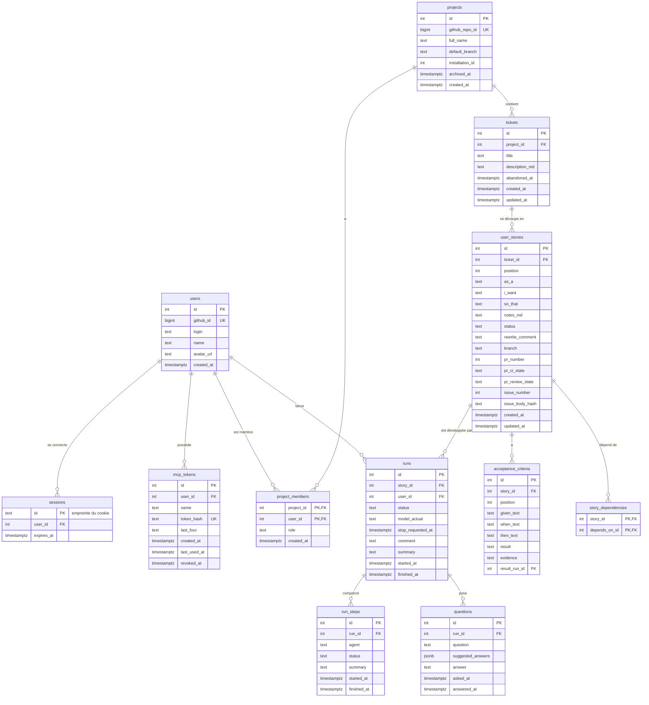

# 002 — Modèle de données

- **Statut** : validée
- **Date** : 2026-10-18
- **Décidé par** : Dorian, avec Claude
- **Modifiée par** : [008 — Service en ligne](008-service-en-ligne.md) : `project_members` remplace `projects.owner_id` ; `github_repo_id` devient unique pour toute l'instance (un repo = un projet) ; dates en `timestamptz`, JSON en `jsonb`, transactions asynchrones
- **Dépend de** : [001 — Stack technique](001-stack.md) (PostgreSQL, Drizzle)

## Contexte

Ce modèle couvre le **MVP** : la boucle cœur en local (phases 1 à 8 du [découpage](../decoupage.md)). Ce qui vient ensuite (pièces jointes, routines, cloud, coût, partage…) s'ajoutera par de nouvelles tables ou colonnes, sans casser celles-ci.

## Principes

1. **On ne stocke pas ce qui se calcule.** L'étape d'un ticket, le verdict d'un run, le bilan de santé et le Kanban se déduisent des données : ils ne peuvent donc jamais se contredire.
2. **GitHub reste la source de vérité** pour les PR, la CI et la configuration Claude des repos. Cockpit en garde au plus une **copie de cache**, tenue à jour par les webhooks et relue par « Actualiser ».
3. **La base fait respecter les règles quand elle le peut** : statuts par contrainte `CHECK`, un seul run actif par US par index unique conditionnel, historique inaltérable par triggers. Une règle tenue par la base ne peut pas être oubliée par le code.

## Schéma

La table `history` n'apparaît pas dans le schéma : elle n'a **volontairement aucune clé étrangère** (voir plus bas).

## Les tables

### Comptes

| Table | Rôle | Règles |
|---|---|---|
| `users` | Un compte GitHub connecté à Cockpit | `github_id` unique. `blocked_at` est renseignée quand l'administrateur bloque le compte : il ne peut plus se connecter (1.6, [012](012-configuration-automatique.md)) |
| `sessions` | Une connexion ouverte dans un navigateur | `id` est l'**empreinte** du cookie : si la base fuit, les sessions restent inutilisables |
| `mcp_tokens` | Un jeton MCP | Seule l'empreinte est stockée ; `last_four` sert à le reconnaître dans la liste. Révoqué = `revoked_at` rempli (4.1) |

### Projets

| Table | Rôle | Règles |
|---|---|---|
| `projects` | Un repo GitHub suivi par Cockpit | `github_repo_id` unique : **un repo GitHub = un projet Cockpit**, ce qui dit sans ambiguïté à quel projet va un webhook ; avec le partage, une deuxième personne sur le même repo y sera ajoutée comme membre (008). **Au MVP**, comme un projet n'a qu'un membre, une deuxième personne qui ajoute un repo déjà suivi est refusée avec un message neutre (« Ce repo est déjà suivi dans Cockpit »), sans dire par qui. *(Avant la 008 : unique sur (`owner_id`, `github_repo_id`), chacun pouvait suivre le même repo de son côté.)* Le repo est identifié par `github_repo_id`, qui survit aux renommages ; `full_name` n'est qu'un affichage. Archivé = `archived_at` rempli |
| `project_members` | Une personne qui travaille sur un projet (008) | Clé primaire sur (`project_id`, `user_id`). `role` ∈ `owner` (`CHECK`) pour l'instant. **Un seul membre par projet au MVP**, garanti par un index unique sur `project_id`, que le partage retirera |

Le **bilan de santé** n'a pas de table : il est relu sur GitHub à chaque affichage. Avec une GitHub App, le webhook est celui **de l'App** et non un webhook par repo : la ligne « webhook installé » du bilan devient « l'App est installée sur ce repo ».

### Tickets et user stories

| Table | Rôle | Règles |
|---|---|---|
| `tickets` | Une idée brute | Pas de colonne d'étape : elle se calcule (voir plus bas). `abandoned_at` couvre le seul cas décidé par l'humain |
| `user_stories` | Une US | `status` ∈ `to_validate`, `to_rewrite`, `ready`, `in_progress`, `in_review`, `done`, `abandoned` (`CHECK`) |
| `acceptance_criteria` | Un Given/When/Then d'une US | `result` ∈ `passed`, `failed` ou vide ; garde le **dernier** compte rendu, avec le run qui l'a donné |
| `story_dependencies` | « Cette US dépend de celle-là » | Clé primaire sur le couple ; une US ne dépend pas d'elle-même (`CHECK`). Sert au rappel au lancement (7.2) |

Sur `user_stories` :

- **`rewrite_comment`** : le commentaire du dernier renvoi. Claude le lit directement, sans fouiller l'historique ; il est vidé à la réécriture.
- **`branch`, `pr_number`** : sur l'US et non sur le run, car une relance réutilise la même branche et la même PR.
- **`pr_ci_state`, `pr_review_state`** : **copie de cache** de GitHub, mise à jour par les webhooks. Elle permet à l'accueil d'afficher « PR dont la CI échoue » sans interroger GitHub à chaque affichage.
- **`issue_body_hash`** : l'empreinte du dernier contenu publié par Cockpit dans l'issue. Si le texte sur GitHub ne correspond plus, l'issue a été modifiée à la main : Cockpit montre le diff entre l'issue et le rendu actuel de l'US (5.2).

### Runs

| Table | Rôle | Règles |
|---|---|---|
| `runs` | Un développement d'une US par Claude Code | `status` ∈ `running`, `succeeded`, `failed`, `stopped`, `closed_manually` (`CHECK`). **Index unique sur `story_id` où `status = 'running'`** : un seul run actif par US, garanti par la base. Arrêt demandé = `stop_requested_at` rempli |
| `run_steps` | Une étape d'un run, faite par un agent | `status` ∈ `running`, `succeeded`, `failed` |
| `questions` | Une question de Claude pendant un run | En attente tant que `answer` est vide. `suggested_answers` : au plus deux réponses proposées par Claude, en JSON, facultatives ([004](004-outils-mcp.md)) |

Le **verdict** de fin de run (« acceptable » ou « à vérifier ») n'est pas stocké : il se calcule à partir des critères et de `pr_ci_state` (7.7).

### Historique

| Colonne | Contenu |
|---|---|
| `id`, `at` | Identifiant et date |
| `user_id` | Le compte **au nom duquel** l'action a eu lieu (vide pour un appel refusé faute de jeton valide) |
| `actor` | `human`, `claude`, `github` ou `system` |
| `origin` | `ui`, `mcp`, `webhook` ou `system` |
| `token_id` | Le jeton MCP utilisé, s'il y en a un |
| `action` | Le nom de l'action métier ou de l'outil MCP |
| `project_id`, `ticket_id`, `story_id`, `run_id` | Les objets concernés, pour filtrer les onglets Historique et le journal global |
| `args` | Les arguments, en JSON, **secrets masqués** |
| `result` | `ok`, `error` ou `refused` |
| `detail` | Le résultat ou le message d'erreur, en JSON |
| `github_effects` | Ce qui a été fait sur GitHub, en JSON |

- Des triggers PL/pgSQL `BEFORE UPDATE`, `BEFORE DELETE` et `BEFORE TRUNCATE` refusent toute modification et toute suppression (`RAISE EXCEPTION`, 008).
- **Aucune clé étrangère** vers les autres tables : un ticket peut être supprimé sans toucher à l'historique, et une entrée garde l'identifiant de l'objet même s'il a disparu.
- Une action et son entrée sont écrites **dans la même transaction** (1.4).

## Ce qui se calcule

### Étape d'un ticket

Dans cet ordre, la première règle qui s'applique l'emporte :

| Étape | Condition |
|---|---|
| Abandonné | `abandoned_at` rempli, **ou** toutes ses US sont abandonnées (et il en a au moins une) |
| Nouveau | Aucune US |
| En cours | Au moins une US `in_progress` ou `in_review` |
| À valider | Au moins une US `to_validate` ou `to_rewrite` |
| Terminé | Toutes ses US sont `done` ou `abandoned`, et au moins une est `done` |
| En cours | Au moins une US `done` et au moins une `ready` (le ticket est entamé) |
| Validé | Les autres cas : toutes ses US non abandonnées sont `ready` |

Deux cas que le brief ne tranchait pas :

- « En cours » passe avant « À valider » : un ticket dont une US est en développement est montré en cours, même si une autre attend encore la validation.
- Un ticket dont une US est terminée et une autre seulement prête est « En cours », pas « Validé » : le travail a commencé.

Un ticket n'est écrit qu'une fois : il n'est proposé à Claude que s'il n'a **aucune** US. Comme les US ne sont jamais supprimées (seulement abandonnées), aucune colonne supplémentaire n'est nécessaire.

### Autres calculs

- **Kanban** : les US du projet regroupées par `status`.
- **Accueil** : des requêtes sur `user_stories` (à valider, PR en revue, CI en échec), `questions` (sans réponse) et `runs` (en cours, échoués).
- **Bilan de santé** : relu sur GitHub.
- **Verdict d'un run** : critères + CI.

## Décisions

1. **L'accès à un projet vit dans `project_members`** (et l'utilisateur sur `sessions`, `mcp_tokens` et `runs`). Tickets, US, critères et étapes y remontent par leur projet. L'accès n'existe qu'à un seul endroit, et le partage de projet (après le MVP) n'aura qu'à ajouter des lignes. Chaque accès passe par une seule fonction qui vérifie que l'utilisateur est **membre** du projet. *(Avant la 008 : `projects.owner_id`.)*
2. **Un ticket ne se supprime que s'il n'a aucune US** (étape « Nouveau »). Ensuite, on l'abandonne. Sinon, supprimer un ticket ferait disparaître des US déjà publiées en issues ou déjà développées.
3. **Le résultat d'un critère est le dernier compte rendu**, stocké sur le critère avec le run qui l'a donné. Les comptes rendus des runs précédents restent dans l'historique. Une table de résultats par run s'ajoutera si l'on veut revoir les critères de chaque run passé.

## Conventions

- **Identifiants** : entiers `generated always as identity`, communs à toute l'instance (US 42, ticket 17). Pas de numérotation par projet.
- **Dates** : `timestamptz` ; Drizzle les rend en `Date` JavaScript, et l'API les envoie en ISO 8601 UTC (`2026-10-18T14:03:00.000Z`). *(Avant la 008 : texte ISO 8601.)*
- **JSON** (`args`, `detail`, `github_effects`, `suggested_answers`) : `jsonb`.
- **Identifiants GitHub** (`github_id`, `github_repo_id`) : `bigint`, car ils peuvent dépasser 2³¹.
- **Noms** des tables, colonnes et valeurs de statut en anglais ; libellés en français dans l'interface.
- **Valeurs fermées** (statuts, acteurs, origines) : colonnes texte avec contrainte `CHECK`, dont Drizzle tire aussi le type TS.
- **Suppressions** : clés étrangères en `ON DELETE RESTRICT` par défaut. Les seules suppressions prévues sont un ticket sans US et les sessions expirées.

## Hors de ce modèle

| Sujet | Où il vivra |
|---|---|
| Chemin du clone local | Dans le navigateur, par projet ([005](005-lancement-local.md)) |
| Modèle demandé pour un run | Dans la fiche de chaque agent, dans le repo ([005](005-lancement-local.md)) ; seul `runs.model_actual` est en base |
| Accès GitHub de Cockpit (jeton de l'utilisateur chiffré ou jeton de l'App) | Tranche 1.3 ; au plus deux colonnes sur `users` |
| Catalogue d'agents et de skills | Des fichiers livrés avec Cockpit, pas des données |
| Pièces jointes, priorité, tags, routines, cloud, coût, notifications, invitations, partage | Après le MVP, par de nouvelles tables ou colonnes |
